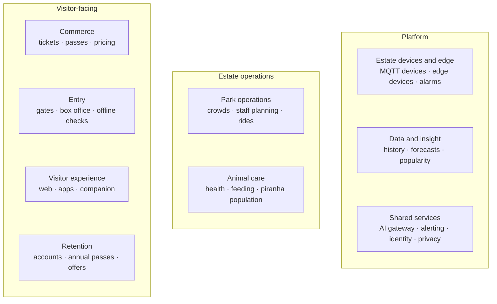

# 1. Introduction and Goals

## 1.1 The estate and its problem

The newly appointed 72nd Countess Von Digitalis has inherited a large estate that loses money. The family's explosive garden gnome business is no longer viable, so the estate must earn its way through visitors:

| Asset | Facts |
|---|---|
| Amusement park | 40 historic 18th-century rides, recently passed safety inspection |
| Animal collection | 200+ exotic and poisonous animals, aquatic and land-based, in 55 displays and enclosures, opening to the public |
| Carnivorous plants | To be sold off if growth targets are missed; growth against target is tracked in the quarterly business review ([section 5.7](05-building-blocks.md#57-estate-performance-reporting)) |
| Visitors | 5,000 a day on average today; the target is at least **15,000 a day within three years** |

## 1.2 What the estate needs: traceability

Each need, constraint and AI concern in the brief, with where it is answered.

| Need (from the brief) | How this architecture answers it | Where |
|---|---|---|
| Buy tickets, including family passes | Own ticketing with one-day tickets, family tickets (2+1, 2+2) and annual passes; time-based pricing set by admins; gates that work without a connection | [Building blocks](05-building-blocks.md), [ADR-004](../adrs/ADR-004-ticketing-build-payments-buy.md), [ADR-019](../adrs/ADR-019-pricing-and-capacity.md) |
| Understand how popular different parts of the park are | Anonymous crowd counting, live waits, and popularity insight combining counts, waits, feedback and repeat visits | [Building blocks](05-building-blocks.md) |
| Track animal health, how much and how well they eat | **AI:** health warnings that compare each animal or group with its own normal, confirmed by keepers | [Animal health warnings](ai/animal-health-warnings.md) |
| Check piranha population levels | **AI:** nightly estimate with a range, reconciled with keeper counts and a log of births, deaths and removals | [Piranha population](ai/piranha-population.md) |
| Know where to invest and deploy staff | **AI:** visitor forecast (4 weeks nightly, up to 3 months on demand) turned into required staff per zone and hour; a management insight assistant answers cross-area questions from checked figures | [Demand forecast and staffing](ai/demand-forecast-staffing.md) · [Insight assistant](05-building-blocks.md#56-management-insight-assistant) |
| Grow visitors and return visits | **AI:** return-visit offers (rules first, then prediction) measured against a holdout group ([section 5.5](05-building-blocks.md)); a visitor companion that plans the day and answers questions in the visitor's language, even with patchy Wi-Fi; offers built on family tickets and annual passes | [Visitor companion](ai/visitor-companion.md) |
| Profitability | Revenue from annual passes, quieter-day demand and seasonal events; low running cost as a deciding quality; AI budgets; managed services instead of building models | [Solution strategy](04-solution-strategy.md) |
| See whether the estate is on track | Live dashboards, daily summary, monthly insight report, quarterly and yearly business review against budget and the growth path | [Estate performance reporting](05-building-blocks.md#57-estate-performance-reporting) |
| At least 15,000 visitors a day within three years | Cloud services scale automatically; gates, entrance Wi-Fi and box office sized for a design day on the busiest days (2–3× average, 30,000–45,000 at year 3) and expanded in modular steps on measured triggers; coarse services split when load proves it | [Sizing](07-deployment.md#74-sizing-and-growth) · [Q13](10-quality-requirements.md) · [ADR-001](../adrs/ADR-001-service-based-architecture.md) |
| Constraint: patchy Wi-Fi | LoRaWAN battery sensors; edge devices with a 72-hour buffer; gates, keeper app and companion core work offline; alarms work without internet | [ADR-002](../adrs/ADR-002-estate-edge-and-connectivity.md) · [ADR-003](../adrs/ADR-003-local-alarm-path.md) · [ADR-018](../adrs/ADR-018-visitor-channels-and-connectivity.md) |
| Constraint: get estate data to the cloud | MQTT ingestion: edge broker → encrypted MQTT → cloud MQTT bridge → message bus; fibre with mobile or satellite backup | [Estate edge](05-building-blocks.md#53-estate-edge) · [Deployment](07-deployment.md) |
| Constraint: budget for MQTT-capable devices | All device data enters as MQTT; LoRaWAN sensors converted to MQTT on site | [ADR-002](../adrs/ADR-002-estate-edge-and-connectivity.md) |
| AI concern: best model changes, prices rise, provider shuts down | One AI gateway with backups, budgets and a release gate; owned data; open-source backups | [AI gateway](ai/ai-gateway-and-fallback.md) · [ADR-006](../adrs/ADR-006-ai-gateway.md) · [ADR-013](../adrs/ADR-013-managed-ai-services.md) |
| AI concern: generative AI is non-deterministic; is it misbehaving? | Test sets run 5 times, grounding checks, production signals with owners, rollback to rules | [ADR-015](../adrs/ADR-015-validating-ai-results.md) · [ADR-007](../adrs/ADR-007-graceful-degradation.md) |

**Diagram 1.1 · Capability map: what the Estate Platform provides**

*Key: grouped boxes are capability areas. How they connect is shown in [Diagram 5.1](05-building-blocks.md).*

## 1.3 Quality goals

These three architecture characteristics (quality attributes) decide between design options. Privacy is treated as a constraint every option must meet.

| Priority | Quality | Why it matters here | Example target |
|---|---|---|---|
| 1 | **Works offline** (availability, offline-first) | Wi-Fi in the park is patchy, and estate data must still reach the cloud | An out-of-range water reading alerts a keeper's radio within **60 seconds** with the internet down |
| 2 | **Easy to change** (modifiability) | AI models, providers and prices change fast; the business is new and will keep adjusting | If the main AI provider shuts down, the companion switches to its backup within **seconds**; after a price rise, traffic moves within **1 day** once tests pass; no app release |
| 3 | **Cheap to run** (cost efficiency) | The estate must become profitable | AI running cost of about **€0.02 per visitor** or less at year 3 |

All quality attribute scenarios are in [Quality requirements](10-quality-requirements.md).

## 1.4 Stakeholders

| Stakeholder | Expects from the architecture |
|---|---|
| The Countess and management | Growth to 15,000 visitors a day, profitability, clear insight into where to invest |
| Visitors (families, tourists, locals, groups, accessibility needs) | Easy booking, short queues, a helpful guide in their language, even without signal |
| Animals (represented by keepers, the vet and zoo licensing inspectors) | Illness spotted early, stable water and temperature, sensors and cameras that cause no stress, welfare records kept |
| Keepers and vet | Early warning of sick animals, simple records that work offline, no false alarm overload |
| Operations and ride maintenance | Staff in the right place, live crowd levels, safe and available rides |
| Box office and gate staff | Fast entry that keeps working during outages |
| Small in-house IT team | Few moving parts, managed services, clear alerts |
| Regulators and auditors | Welfare, safety and data-protection records on request |
