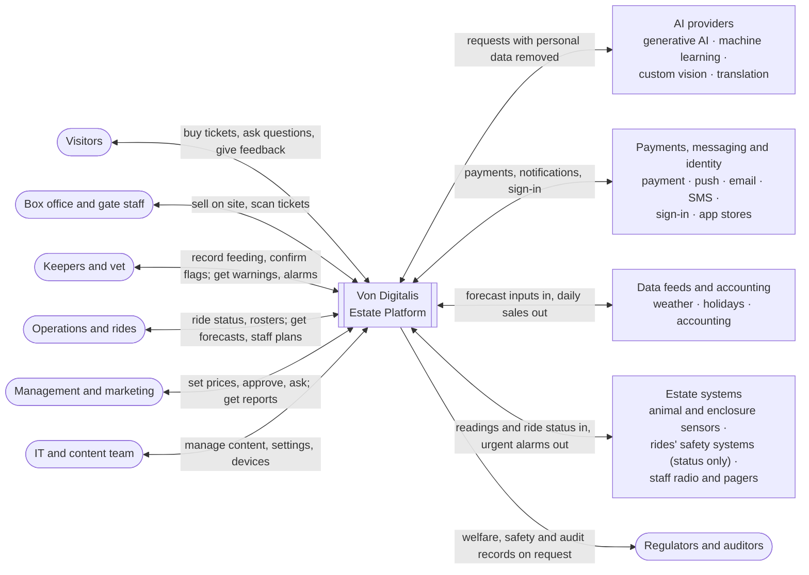
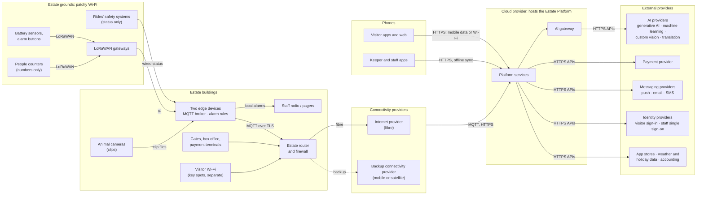

# 3. Context and Scope

## 3.1 System boundary

The system is the **Von Digitalis Estate Platform**: our cloud services, the visitor and staff apps, the edge devices and message broker on site, and the sensors, counters and cameras we install. People, external providers, the rides' own safety systems and the staff radio system are outside it.

| In scope | Out of scope |
|---|---|
| Ticketing (one-day tickets, family tickets, annual passes), pricing rules, gates and box office | Food, retail and third-party stalls (future integration point) |
| Visitor web app, native apps and companion | Reseller and tour-operator channels |
| Park operations: crowd levels, forecasts, staff planning, ride status | Number of entry lanes and turnstiles (operations decision) |
| Animal care: records, health warnings, piranha population | Controlling rides or their safety systems |
| Estate devices, edge devices, site-to-cloud link | Building payment processing |
| Data and insight, AI gateway, alerting, identity | Researching or hand-building AI models (we configure managed services and standard open-source methods on our own data) |

## 3.2 Business context

Who and what the platform exchanges information with.

**Diagram 3.1 · Business context (C4-style system context): the Estate Platform, its users and outside parties**

*Key: the double-bordered box in the middle is the system we design; rounded boxes are people; other boxes are external providers (named by role, not vendor) or estate systems outside it; arrow labels say what is exchanged. Every party is listed in the table below.*

| Party | Gives the platform | Gets from the platform |
|---|---|---|
| Visitors | Bookings, preferences, questions, feedback, zone location (with consent) | Tickets and passes, day plans, answers, wait times, offers |
| Box office and gate staff | On-site sales, ticket scans | Ticket and pass validation, sales records |
| Keepers and vet | Observations, feeding records, diagnoses, piranha counts, population events | Health warnings, briefings, alarms, population estimates |
| Operations and ride maintenance | Rosters, ride status, incidents | Forecasts, staff plans, crowd levels, ride wear reports |
| Management and marketing | Pricing rules, approvals, campaigns, questions to the insight assistant | Insight reports, dashboards, price suggestions, assistant answers and quick reports |
| IT and content team | Settings, content, approvals of AI drafts | Device and service health, content drafts |
| Payment provider | Payment results | Payment requests (card data never passes through the platform) |
| AI providers (generative AI, machine learning, custom vision, translation) | Model results | Requests with personal data removed |
| Weather and holiday data | Forecasts, school and public holidays | — |
| Messaging providers (push, email, SMS) | Delivery status | Push, email and SMS to send |
| App stores and sign-in providers (visitor sign-in, staff single sign-on) | Sign-in confirmation; app distribution | Sign-in requests; app releases |
| Accounting system | Budget figures | Daily sales and revenue export |
| Animals and enclosures | Readings via sensors, clips via animal cameras | — |
| Rides' safety systems | Ride status (read-only) | Nothing |
| Staff radio / pager system | Acknowledgements, where supported | Urgent alarms |
| Regulators and auditors (zoo licensing, ride safety, data protection) | — | Welfare and inspection records, audit trails, data-protection responses (produced on request) |

## 3.3 Technical context

The channels each party uses, and whether they work without internet.

**Diagram 3.2 · Technical context: channels between phones, grounds, buildings, cloud and external services**

*Key: grouped boxes are locations or providers; arrow labels name the channel; dotted = backup path. Site detail is in Diagram 7.2.*

| Channel | From → to | Works without internet? |
|---|---|---|
| LoRaWAN | Battery sensors, alarm buttons, people counters → LoRaWAN gateways → edge devices | Yes (local) |
| MQTT | Wired devices and camera status → edge devices (MQTT broker); animal camera clips uploaded as files | Yes (local) |
| Local alarm path | Edge devices → staff radio / pagers; SMS from the edge devices' own mobile modems (needs mobile signal, not internet) | **Yes** |
| Estate internet link (fibre + mobile or satellite backup) | Broker, gates, box office, animal camera clips, visitor Wi-Fi → cloud | No: buffered and sent when the link returns |
| HTTPS over mobile data or visitor Wi-Fi | Visitor apps and web → cloud | No: app core works offline |
| HTTPS with offline sync | Keeper and staff apps, gates, box office → cloud | Yes: sync later |
| Card terminals | Box office → payment provider | Switch to their own mobile connection, then the provider's offline mode |
| HTTPS APIs | Cloud → payment, AI, messaging, identity, weather and holiday data, accounting | Cloud side only |
| Status feed (read-only) | Rides' safety systems → edge devices, wired from ride stations | Yes (local) |

## 3.4 External providers

Named **by role, not vendor**: the brief doesn't ask for vendors, and naming roles keeps every provider replaceable (avoiding vendor lock-in). Example products for each role, to show the design can be built today, are in [section 7.5](07-deployment.md#75-example-technologies). Vendors are chosen at procurement against these criteria: open standards, full data export, hosting region, no training on our data, and a realistic alternative.

| Provider (role) | Used for | Used by | Channel | If unavailable | How we can switch |
|---|---|---|---|---|---|
| Cloud provider | Hosts all cloud services | All blocks | — | Site keeps working locally: alarms, gates, box office, keeper app | Containers, MQTT and the AI gateway are portable; managed services have equivalents on other clouds |
| Internet provider (fibre) | Estate link to the cloud | Estate edge, gates, box office | Fibre | Backup connectivity provider takes over | Standard contract |
| Backup connectivity provider (mobile or satellite) | Failover link | Estate router | Mobile or satellite | Local operation; readings buffered up to 72 h | Standard contract |
| Mobile network operator | Payment terminal backup link, SMS alarm backup | Entry, Alerting | Mobile | Payment provider's offline mode; radio for alarms | Second SIM |
| Generative AI provider | Companion answers, keeper briefings, insight reports, management insight assistant, translation drafts | AI gateway | HTTPS API | Second provider behind the gateway, then prepared answers | Gateway routing; re-test before switching |
| Managed machine learning provider | Forecasting, anomaly detection | Data and insight, Animal care | HTTPS API | Calendar rules, keeper thresholds | Retrain elsewhere on our own history in the data hub |
| Custom vision provider | Piranha detection; food tray estimates and visible change checks (pilots) | Animal care | HTTPS API | Keeper counts and event log; keeper-entered leftovers and observations | Labelled frames and photos kept in the data hub for retraining elsewhere |
| Translation provider | Translating approved content | Visitor experience | HTTPS API | Existing approved translations | Behind the AI gateway |
| Payment provider | Online and terminal payments | Ticketing, Entry | HTTPS API, terminals | Cash on site; online sales pause | Payment connector isolates the provider |
| Push notification services | App notifications | Visitor experience, Alerting | HTTPS API | Email for visitors; radio for staff | Required by the phone platforms |
| Email provider | Tickets, receipts, offers | Ticketing, Loyalty and offers | HTTPS API | Tickets remain in the app; messages retried | Standard email interface |
| SMS provider | Cloud-side staff alerts (on-site alarms use the edge devices' own mobile modems) | Alerting | HTTPS API | Radio, pagers and on-site SMS | Standard SMS interface |
| App stores | Native app distribution | Visitor experience | — | Web app | Required for native apps |
| Visitor sign-in providers | Sign-in with existing accounts | Identity and settings | OpenID Connect | Email sign-in | Standard protocol |
| Staff single sign-on provider | Staff sign-in | Identity and settings | OpenID Connect or SAML | Keeper app stays signed in for the shift; emergency accounts | Standard protocols |
| Weather data provider | Forecast inputs | Data and insight | HTTPS API | Forecasts run without weather | Swap the data feed |
| Holiday calendar provider | School and public holidays | Data and insight, Ticketing (pricing rules) | HTTPS API or file | Manually maintained calendar | Swap the data feed |
| Accounting system | Daily sales export; budget figures for performance reports | Ticketing | File or API export | Export queued until available | Export format |
| Hardware vendors (sensors, cameras, gateways, radios, terminals) | Devices on site | Estate edge | LoRaWAN, MQTT | Spares on site | Open standards: LoRaWAN, MQTT |

