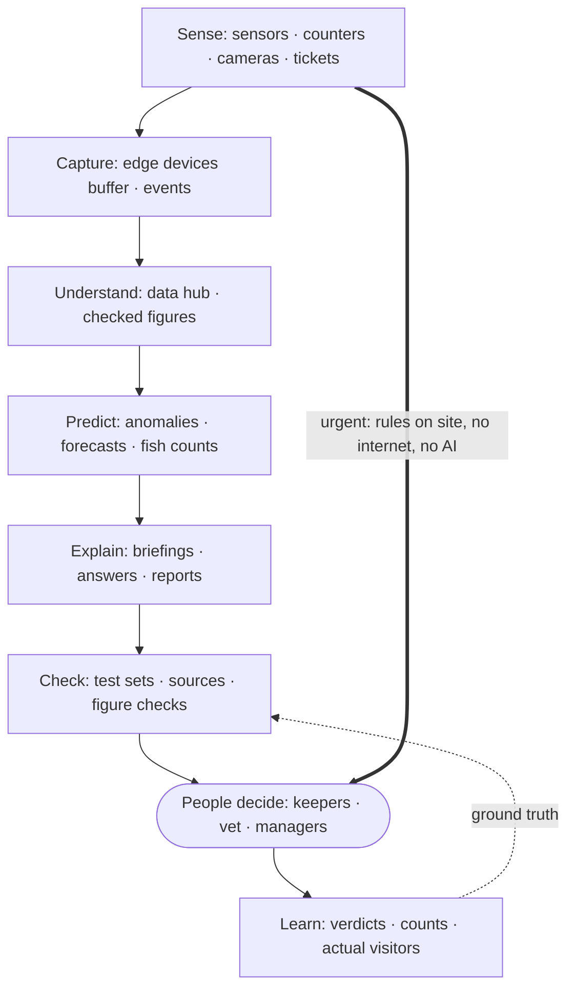

# 4. Solution Strategy

The architecture in one page: the fundamental decisions and how they achieve the quality goals.

## 4.1 Fundamental decisions

| Decision | Summary | ADR |
|---|---|---|
| **Service-based architecture** | About ten coarse services: seven domain services (one per bounded context) and three platform services, communicating through integration events (publish-subscribe); any service can be split further if load or change demands it | [ADR-001](../adrs/ADR-001-service-based-architecture.md) |
| **Edge on site, platform in the cloud** | LoRaWAN battery sensors and MQTT devices report to two small edge devices on site, which run alarm rules and buffer data; everything else runs on managed cloud services | [ADR-002](../adrs/ADR-002-estate-edge-and-connectivity.md) |
| **Alarms never depend on the internet** | Urgent readings raise alarms through the edge devices to staff radios and pagers, with SMS from the edge devices' own mobile modems as backup | [ADR-003](../adrs/ADR-003-local-alarm-path.md) |
| **Own ticketing, bought payments** | We own tickets, passes, pricing rules and offline gate checks; card handling stays with a payment provider | [ADR-004](../adrs/ADR-004-ticketing-build-payments-buy.md) |
| **Cloud AI, no AI servers on site** | AI runs in the cloud unless people on the ground need it instantly, offline, and it's too heavy for devices or phones; nothing currently meets that test | [ADR-005](../adrs/ADR-005-cloud-first-ai.md) |
| **One AI gateway** | Every AI call goes through one gateway: provider fallback, budgets, rate limits, personal-data removal, guardrails, versioned prompts and models | [ADR-006](../adrs/ADR-006-ai-gateway.md) |
| **Every AI feature has a non-AI fallback** | Each feature starts as rules and falls back to them (graceful degradation) when AI is unavailable, too costly or switched off; the estate runs with no AI at all | [ADR-007](../adrs/ADR-007-graceful-degradation.md) |
| **Clear limits on AI autonomy** | AI acts alone only when safe and reversible; people confirm money, prices, animal care and publishing (human-in-the-loop); AI never touches safety systems | [ADR-008](../adrs/ADR-008-ai-autonomy-levels.md) |
| **Validate every AI feature** | Ground truth, test sets run by an evaluation harness, shadow deployment, a release gate (evaluation gate) for every change, canary releases, production monitoring including drift, rollback | [ADR-015](../adrs/ADR-015-validating-ai-results.md) |
| **Generative AI only for language** | Rules, statistics, forecasting and vision for alarms, prices, health, counts and forecasts; generative AI only for answers, briefings and summaries | [ADR-016](../adrs/ADR-016-where-generative-ai-is-not-used.md) |
| **Privacy by design** | Counting inside devices, zone location with consent, minimal data, personal data removed before AI | [ADR-017](../adrs/ADR-017-privacy-by-design.md) |
| **Web and native apps with an offline core** | Tickets, guide, map and plan work without signal; visitor Wi-Fi guaranteed at key spots | [ADR-018](../adrs/ADR-018-visitor-channels-and-connectivity.md) |
| **Pricing as data, slots only on the busiest days** | Time-based rules; forecast-driven price suggestions (rules on the AI forecast) approved by admins; timed arrival slots only on forecast busiest days | [ADR-019](../adrs/ADR-019-pricing-and-capacity.md) |
| **New platform as the baseline** | Minimal existing systems kept; AI features added on top of a platform that works without them | [ADR-020](../adrs/ADR-020-new-platform-as-baseline.md) |
| **Use managed AI, don't build models** | Managed forecasting and anomaly detection, pre-trained generative AI, vendor devices; the one exception is custom-labelled vision on managed services (piranhas, food trays) | [ADR-013](../adrs/ADR-013-managed-ai-services.md) |

## 4.2 How the quality goals are achieved

| Quality goal | Approach |
|---|---|
| **Works offline** (availability) | Alarm rules and buffering on redundant edge devices · gates check signed tickets and passes offline · keeper app and companion core work without signal · all readings synced when the link returns |
| **Easy to change** (modifiability) | Coarse services with events between them · AI providers, models and prompts behind one gateway · prices, thresholds and feature switches are settings · providers named by role, each replaceable |
| **Cheap to run** (cost efficiency) | Managed services · no AI servers on site · battery sensors instead of cabling · nightly batch AI · token budgets and hard stops per AI feature (FinOps) · no extra licences for scheduling |
| Capacity (scalability): 15,000 visitors a day (requirement) | A light load for cloud services, which scale automatically · the real limits are physical: gates and entrance Wi-Fi for about 6,000 arrivals an hour on a design day, with timed arrival slots above that and capacity added in modular steps · companion AI cost capped per visitor · services split only when measured load demands |
| Privacy (constraint) | People-counting devices send numbers only · location shared as a zone with consent · personal data removed before AI · conversations stay on the phone |

## 4.3 Where AI is used, and where it deliberately isn't

| AI use | Answers the brief's need | Details |
|---|---|---|
| Animal health warnings | Animal health and eating | [ai/animal-health-warnings.md](ai/animal-health-warnings.md) |
| Piranha population estimate | Piranha population levels | [ai/piranha-population.md](ai/piranha-population.md) |
| Demand forecast → staff planning | Where to invest and deploy staff | [ai/demand-forecast-staffing.md](ai/demand-forecast-staffing.md) |
| Visitor companion | AI for customers, more visitors and return visits | [ai/visitor-companion.md](ai/visitor-companion.md) |

| Deliberately not AI | Why |
|---|---|
| Urgent alarms (water quality, temperature, alarm buttons) | Must be instant, predictable and work offline: simple rules |
| Live crowd levels and wait times | Counts and arithmetic are accurate enough; no model needed |
| Safety answers in the companion | Fixed, approved answers; one wrong generated answer about a venomous animal is unacceptable |
| Ticket prices | Rules on the AI forecast only suggest; an admin approves; prices are locked per order |
| Staff assignment | Managers assign named staff; AI provides the numbers |

## 4.4 How the solution evolves

| Phase | Platform | AI |
|---|---|---|
| Before opening | Sensors installed, edge devices, ticketing, apps with offline guide | Rules only; 4–8 weeks of normal animal readings collected |
| Year 1 | Growth to ~8,500 visitors a day | Anomaly detection and managed forecasting once data allows; companion AI answers after a staff pilot; rule-based return-visit offers; management insight assistant pilot for sales, crowds and forecasts |
| Years 2–3 | Growth to 15,000 visitors a day; on-site hardware scaled on measured triggers | Combined-signal health models, forecasts learned from a full year of history, day plans, prediction of who will return; assistant tools for animal care and offers |

## 4.5 The intelligence pipeline

How the building blocks work together, from a reading on site to a decision by a person. Each AI use follows this path; urgent alarms deliberately skip it.

**Diagram 4.1 · The intelligence pipeline: from sensing to people deciding, with the alarm shortcut**

*Key: boxes are stages; rounded box is people; thick arrow is the alarm shortcut; dotted arrow feeds real outcomes back into the checks.*

| Stage | What happens | Example |
|---|---|---|
| Sense | Devices and systems record what happens | Feeding scale, people counter, ticket scan |
| Capture | Edge devices buffer readings and publish events, even when the internet is down | "Reading received", "Entry recorded" |
| Understand | The data hub keeps history and calculates checked figures | A lizard's normal food intake; visitors per zone |
| Predict | Machine learning and vision, only where rules aren't enough | Intake 30% below normal for 3 days |
| Explain | Generative AI turns results into language, never into figures | Keeper briefing; manager assistant answer |
| Check | Every output checked before and after release ([ADR-015](../adrs/ADR-015-validating-ai-results.md)) | Test sets, sources shown, untraceable figures blocked |
| People decide | Keepers, the vet and managers act ([ADR-008](../adrs/ADR-008-ai-autonomy-levels.md)) | Keeper checks the lizard today |
| Learn | Outcomes recorded by people become ground truth | Keeper verdict "real concern" improves the next release check |

Not every AI use needs every stage: forecasts skip "Explain", and the piranha estimate goes straight from "Check" to the keeper's view.
