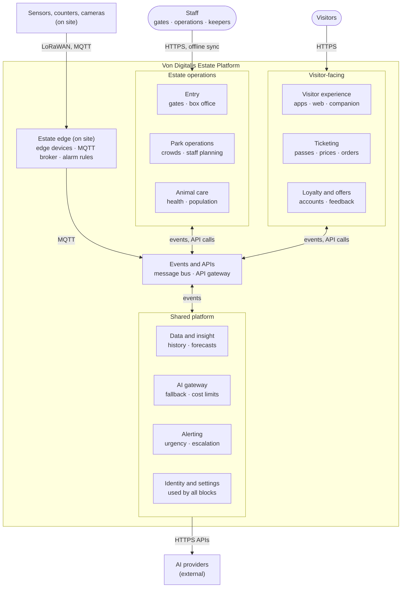
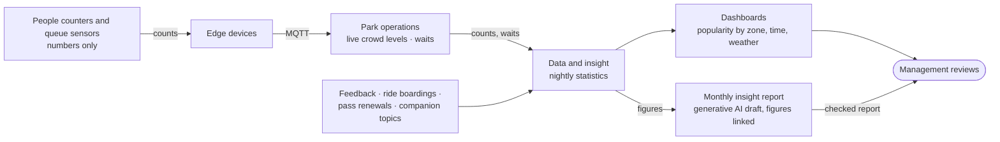
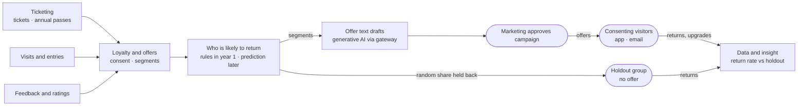
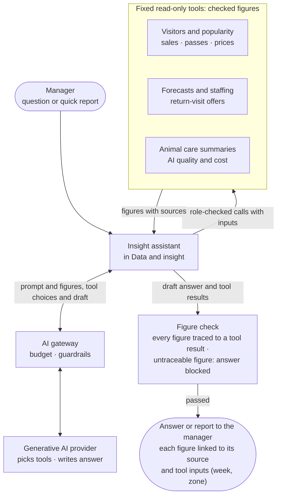

# 5. Building Block View

The platform is **service-based**: about ten coarse services: seven domain services, each a bounded context in domain-driven design terms, and three platform services (AI gateway, alerting, identity), exchanging integration events (publish-subscribe) and API calls. Any service can be split further if load or change requires it ([ADR-001](../adrs/ADR-001-service-based-architecture.md)).

## 5.1 Level 1: the whole platform

**Diagram 5.1 · Building block view, level 1 (C4-style container view): main blocks of the Estate Platform and how they interact**

*Key: rounded boxes are people; boxes inside the platform are building blocks, grouped by area; arrow labels give the channel. All blocks exchange events and API calls through "Events and APIs". Each service owns its own database (database per service); data is shared only through domain events and APIs. Detailed block-to-block flows are in the table below; all external services are in Diagram 3.2.*

| Relationship | What flows | Channel | Works offline? |
|---|---|---|---|
| Visitors → Visitor experience | Browse, buy, ask | HTTPS over mobile data or Wi-Fi | App core only |
| Visitor experience → Ticketing → Payment provider | Ticket and pass purchases | HTTPS; provider API | No |
| Entry ↔ Ticketing | Ticket and pass lists down; scans and box office sales up | HTTPS sync | **Yes**, syncs later |
| Sensors → Estate edge → staff radio | Urgent alarms | LoRaWAN / MQTT, local | **Yes** |
| Estate edge → Events and APIs | All readings, counts, alarms | MQTT bridge over estate internet | Buffered on site |
| Events and APIs → Data and insight, Animal care, Park operations, Loyalty | Business events | Message bus | Cloud side |
| Data and insight → Park operations → Visitor experience | Forecasts; live waits | Events | Cloud side |
| Visitor experience, Animal care, Data and insight → AI gateway → AI providers | All AI calls | HTTPS APIs | No: features fall back |
| Animal care → Alerting → Keepers | Health warnings ("check today") | Keeper app and morning briefing | App works offline, syncs later |
| Identity and settings | Sign-in, roles, settings, AI switches | Used by all blocks | Cached tokens offline |

### Key integration events

| Event | Produced by | Used by |
|---|---|---|
| Ticket sold, pass renewed | Ticketing | Data and insight, Loyalty and offers, Entry |
| Entry recorded | Entry | Park operations, Data and insight |
| Reading received, alarm raised | Estate edge | Animal care, Alerting, Data and insight |
| Crowd count updated | Estate edge | Park operations, Visitor experience |
| Health flag raised, keeper verdict recorded | Animal care | Alerting, Data and insight |
| Population event recorded | Animal care | Data and insight (piranha reconciliation) |
| Forecast published | Data and insight | Park operations, Ticketing (price suggestions), Visitor experience |
| Feedback submitted | Visitor experience | Loyalty and offers, Data and insight |

The AI additions consume and publish the same events as the rest of the platform, so they add no new integration style.

## 5.2 Level 2: inside each block

| Block | Parts | AI features hosted | Owns data | Runs |
|---|---|---|---|---|
| Ticketing | Product catalogue (one-day, family 2+1 / 2+2, annual pass) · pricing rules · orders and refunds · signed ticket issuing · payment connector | Forecast-driven price suggestions (rules, admin approves) | Products, prices, orders, passes | Cloud |
| Entry | Gate scanning · offline ticket and pass cache · revocation list · box office sales · reconciliation | — | Entries, box office sales, offline cache on gates | On site (gates, box office) + cloud |
| Visitor experience | Web app · native apps · offline content packs · map · companion service · day planner · content management | **Companion** · day plan · translations | Content, translations, content index | Phones + cloud |
| Loyalty and offers | Visitor accounts and consent · annual pass holders · feedback collection · offer campaigns | Return-visit offers · feedback insight | Visitor accounts, consent, campaigns, feedback | Cloud |
| Park operations | Ride status · live crowd and waits · staff planning (required staff per zone and hour) · incidents · ride usage | **Demand forecast → staff planning** · popularity insight | Ride status, crowd counts, staff plans | Cloud |
| Animal care | Animal and group registry · feeding records · observations form with photos · enclosure readings · health warnings · population log · keeper app | **Health warnings** · **piranha estimate** · keeper briefing | Animal registry, care records, photos, flags and verdicts, population log | Keeper app + cloud |
| Data and insight | Raw event store · curated history · checked figures · dashboards · batch jobs · insight reports · model monitoring | Monthly insight report narrative · **management insight assistant** | Data hub (object storage): event history, checked figures | Cloud |
| AI gateway | Provider routing and failover · budgets and rate limits · personal-data removal and guardrails · prompt and model registry · key vault · content answer cache · logs and tracing | (serves all AI features) | Prompt and model registry, AI logs (30 days) | Cloud |
| Alerting | Alert rules by urgency · on-call rota · escalation · delivery to radio, app push, SMS, email | — | Alert rules, on-call rota, alarm history | Edge devices (urgent, local) + cloud |
| Estate edge | LoRaWAN gateways and network server · MQTT broker · local alarm rules · store-and-forward buffer · device health · faulty-sensor rules | Faulty sensor detection (rules on site, statistics in cloud) | Local buffer on the edge devices (72 h) | Two edge devices on site |
| Events and APIs | Cloud message bus · MQTT bridge from site · API gateway for apps | — | Messages in transit only | Cloud |
| Identity and settings | Staff single sign-on · visitor accounts · roles · settings · AI feature switches · audit log | — | Staff roles, visitor sign-in, settings | Cloud |

## 5.3 Estate edge

Runs on two small industrial edge devices on site, active-standby (active-passive failover), on backup power and managed remotely ([ADR-002](../adrs/ADR-002-estate-edge-and-connectivity.md)). Its devices and connections are shown in [Diagram 7.2](07-deployment.md).

| Part | Responsibility |
|---|---|
| LoRaWAN network server | Receives battery sensors, counters and alarm buttons via overlapping gateways; publishes messages to MQTT |
| MQTT broker (MQTT ingestion on site) | Single entry point for all device data, including wired and Wi-Fi devices; forwards everything over encrypted MQTT to the cloud MQTT bridge, which publishes to the message bus |
| Local alarm rules | Urgent thresholds (e.g. water oxygen, temperature, alarm buttons); alert staff radios and pagers without internet ([ADR-003](../adrs/ADR-003-local-alarm-path.md)) |
| Store-and-forward buffer | Keeps readings for at least 72 hours during outages; sends alarms first, then latest readings, then backlog |
| Gate sync | Shares ticket lists, cancelled tickets and entries between gate lanes when the cloud is unreachable |
| Device health | Detects silent, stuck or impossible readings; urgent for animal sensors |

## 5.4 Popularity insight

Answers "which parts of the estate are most popular" and "where to invest". Footfall alone isn't popularity, so several signals are combined.

| Signal | Source |
|---|---|
| Anonymous zone counts (footfall) and time spent (dwell time) | People counters (numbers only) |
| Queue lengths and ride boardings | Park operations |
| Ratings and feedback themes | Visitor app and post-visit survey |
| Repeat visits | Annual passes and accounts |
| Companion questions (anonymised topics) | Visitor companion |

**Diagram 5.3 · Building block view: popularity insight**

*Key: boxes are building blocks or data; rounded box is people; arrow labels say what flows. Only numbers leave the counters.*

| Output | Method | Frequency |
|---|---|---|
| Live crowd levels and waits | Counts and arithmetic (deliberately not AI) | Every minute |
| Popularity patterns by zone, time, weather and visitor type | Descriptive statistics | Nightly |
| Monthly insight report for management | **Data-to-text generation** by an LLM over the statistics, each statement linked to its numbers (citation check) | Monthly |

| Aspect | Approach |
|---|---|
| How we know the report is right | Every figure in the monthly report is traced automatically to its data; a report with an untraceable figure is not released; management reviews it before sharing |
| Fallback | Dashboards only, without the narrative |
| Why not more AI | Popularity needs exact, repeatable numbers, so it uses statistics; generative AI only writes the narrative ([ADR-016](../adrs/ADR-016-where-generative-ai-is-not-used.md)) |

## 5.5 Growth and return visits

Answers "work out how to grow the number of visitors, but also make the estates more profitable" and "we want to get more returning visitors too, but aren't sure how" ([ADR-023](../adrs/ADR-023-return-visit-offers.md)).

| Lever | How | Serves |
|---|---|---|
| Annual pass upgrade | Day-ticket price credited if upgraded within 7 days; offered at exit, in the app and by email | Return visits, revenue |
| What's new for pass holders | New animals, feeding shows and seasonal events (e.g. Christmas) announced to pass holders | Return visits |
| Quieter-day offers | Price suggestions for dates ahead ([ADR-019](../adrs/ADR-019-pricing-and-capacity.md)) sent to consenting visitors | Visitor growth, profit |
| Fix what visitors dislike | Feedback themes reported monthly to management | Return visits |
| "What's new since your last visit" | Shown by the [companion](ai/visitor-companion.md) to returning visitors | Return visits |

**Diagram 5.8 · Building block view: growth and return visits**

*Key: boxes are building blocks or data; rounded boxes are people; arrow labels say what flows. A random share of consenting visitors gets no offer, so the effect of offers can be measured.*

| Aspect | Approach |
|---|---|
| Year 1 (day-one version) | **Rule-based segments**: family ticket buyers → school holiday events; repeat day visitors → annual pass upgrade; pass holders → what's new |
| Later | **Propensity modelling** (supervised classification: who is likely to return or upgrade) with managed machine learning, run as a nightly batch, once a season of visit history exists |
| Offer text | Generative AI drafts; **marketing approves every campaign** ([ADR-008](../adrs/ADR-008-ai-autonomy-levels.md)) |
| How we know it works | A **holdout group** (control group, as in an A/B test) of about 10% of consenting visitors gets no offers; return and upgrade rates are compared to measure the uplift; a segment's offers stop if they show no uplift over two campaigns |
| Fallback | Rule-based segments and standard seasonal messages |
| Privacy | Consenting visitors only; no gender, age or children's data used for targeting; unsubscribe at any time ([ADR-017](../adrs/ADR-017-privacy-by-design.md)) |
| Targets | Return rate against the holdout group and annual pass share of visits; target values in [section 10.3](10-quality-requirements.md#103-ai-quality-targets) |

**Profitability levers:** revenue from annual passes, quieter-day demand and seasonal events; costs held down by staff planning, fewer animal illnesses and capped AI running costs. Food, retail and venue hire are natural next revenue streams, but the brief doesn't ask for them; they can plug into the same events and visitor accounts later.

## 5.6 Management insight assistant

Answers the questions managers ask across areas, such as "which zones got busier after the new feeding show, and did we staff them enough?", in plain language, and builds quick reports on demand. It is a lighter AI use, not a flagship: it adds no new data, only a faster way to reach the figures the platform already produces ([ADR-021](../adrs/ADR-021-management-insight-assistant.md)).

| Area | Example questions | Tools read from |
|---|---|---|
| Visitors and popularity | "Busiest zones last Saturday?" · "What do visitors complain about most this month?" | Park operations (crowds, waits) · feedback themes |
| Sales, passes and prices | "Family ticket sales this month against last year?" · "How did the quieter-day price do?" | Ticketing |
| Forecasts and staffing | "Expected visitors next bank holiday, and staff needed per zone?" | Data and insight (forecasts) · staff planning |
| Return visits | "Did the annual pass offer beat the holdout group?" | Loyalty and offers |
| Animal care | "Health flags this week by enclosure, and how many keepers confirmed?" · "Piranha estimate trend?" | Animal care (summaries only; no diagnosis) |
| AI quality and cost | "Which AI feature is closest to its budget?" | AI gateway metrics |

**Diagram 5.9 · Building block view: management insight assistant**

*Key: rounded boxes are the manager's question and the answer they receive; boxes are building blocks; the grouped box is the set of tools. Tools only read figures that dashboards already show; the model never queries databases directly.*

| Aspect | Approach |
|---|---|
| AI method | **LLM tool calling** (function calling) over the semantic layer: a restricted agent that may only choose among fixed read-only tools, then **data-to-text generation** for the answer |
| How figures stay right | Tools return figures from the data hub's semantic layer, with the same definitions as the dashboards; every figure in an answer links to its tool result; an answer with an untraceable figure is blocked. The check proves where a figure came from, not that it answers the question, so each answer shows the tool inputs used (week, zone) |
| Quick reports | Saved questions combined into a one-page report, on demand or weekly by email; same figure check as the monthly insight report |
| Questions it can't answer | Says so, links the nearest dashboard, and logs the question as a request for a new tool |
| Access and privacy | Tools check the manager's role; totals only, never individual visitors |
| What it may not do | Change prices, publish, send offers or assign staff; it only reads and explains ([ADR-008](../adrs/ADR-008-ai-autonomy-levels.md)) |
| Checks before release | About 150 real manager questions with answers taken from dashboards, including ambiguous and paraphrased ones: at least **95%** of figures match; **100%** of out-of-scope and wrong-role questions refused |
| Monitoring in production | Blocked answers above **2%** in a week → review tools and prompt · answers rated unhelpful above **20%** → review · weekly sample checked by the data owner |
| Fallback | Dashboards and the monthly insight report |
| Offline | Office use only; not needed when the internet is down |
| Roll-out | Year 1 pilot with sales, crowds and forecasts; animal care and offer tools added as those features go live |
| Rough cost (year 3) | About 30 users and 1,000 questions a month: **under €1K a year** |

## 5.7 Estate performance reporting

How the Countess and management see whether the estate, and the platform itself, are on track. Budgets and accounts stay in the accounting system; the platform imports the budget figures and reports actual results against them.

| Report | How often | Contents | For |
|---|---|---|---|
| Live operations dashboard | Every minute | Visitors in the park, waits, sales today, open alarms, device and service health | Operations, duty manager |
| Daily summary | Each morning | Yesterday's visitors and revenue against forecast and budget, health flags, incidents | Management |
| Monthly insight report | Monthly | Popularity, feedback themes, return-visit results, AI quality and cost against budget ([section 5.4](#54-popularity-insight)) | Management |
| Business review | Quarterly and yearly | Visitors against the path to 15,000 a day (8,500 · 12,000 · 15,000); revenue, revenue per visitor and annual pass share against budget; staff hours against plan; animal care indicators (flags, confirmed illnesses, vet cases); AI running cost; platform availability | The Countess and management |
| Insight assistant | On demand | Any of the above, asked in plain language ([section 5.6](#56-management-insight-assistant)) | Managers |

| Aspect | Approach |
|---|---|
| Budget figures | Imported monthly from the accounting system; actual sales exported to it daily |
| Figures | Checked figures from the data hub's semantic layer, with the same definitions in every report; generative AI writes narrative only, and every figure is traced |
| Is the platform working? | Every report includes a status panel: last alarm-path test, device health, AI features running on their rules fallback, AI signals over threshold, cost against budget |
| Fallback | Dashboards and exported figures without narrative |

## 5.8 Level 2 and 3 views of the AI features

| Diagram | Where |
|---|---|
| 5.2 AI gateway | [AI gateway and fallback](ai/ai-gateway-and-fallback.md) |
| 5.4 Animal health warnings | [Animal health warnings](ai/animal-health-warnings.md) |
| 5.5 Piranha population estimate | [Piranha population](ai/piranha-population.md) |
| 5.6 Demand forecast and staff planning | [Demand forecast and staffing](ai/demand-forecast-staffing.md) |
| 5.7 Visitor companion | [Visitor companion](ai/visitor-companion.md) |
