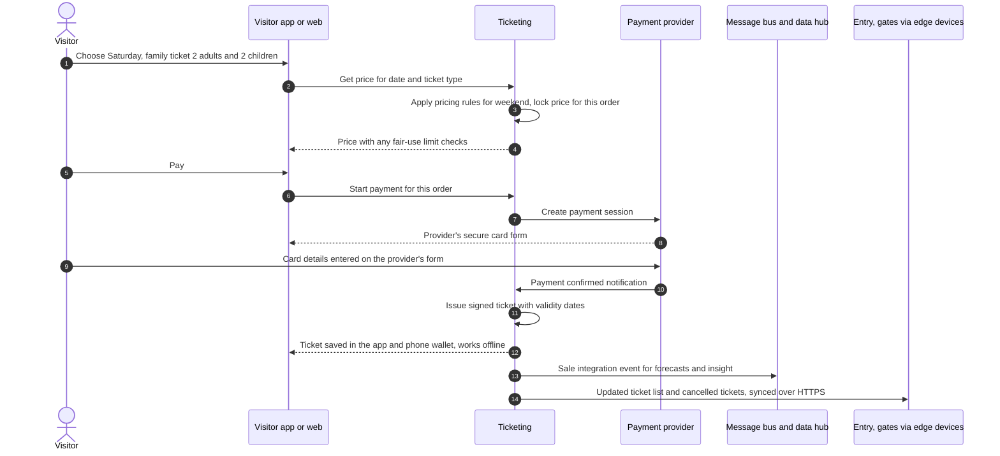
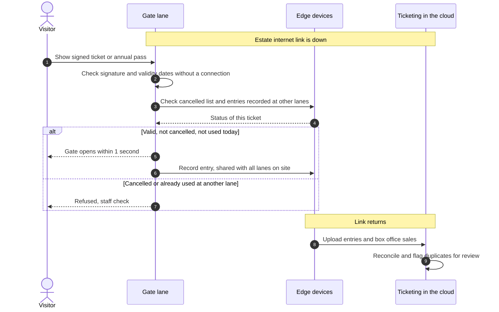
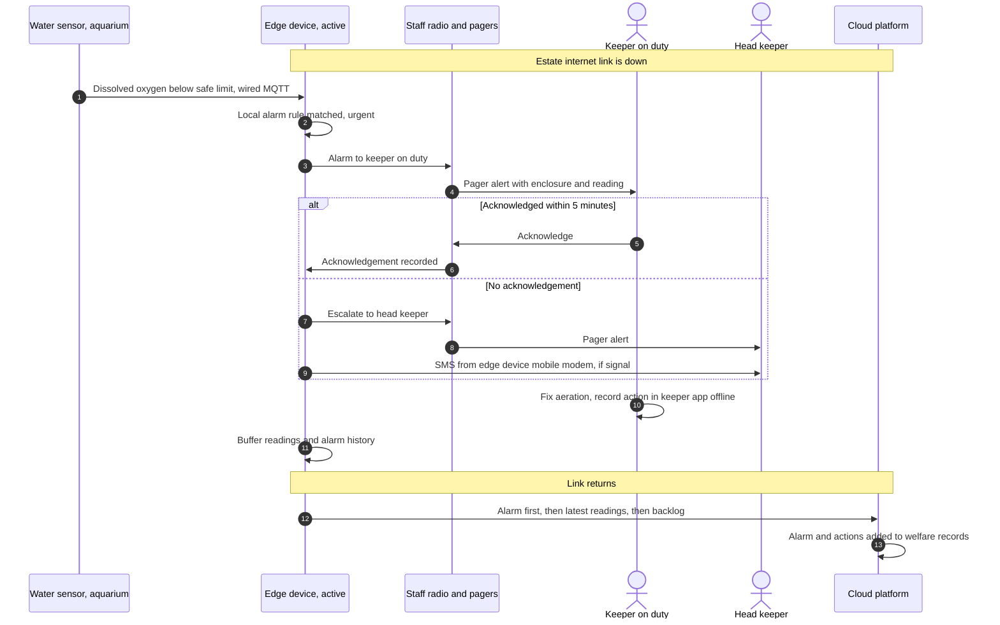

# 6. Runtime View

Key scenarios, step by step. Platform scenarios are shown here; each AI use has its own runtime view.

| Diagram | Scenario | Where |
|---|---|---|
| 6.1 | Buying a family ticket online | Below |
| 6.2 | Entry at the gate with the internet down | Below |
| 6.3 | Urgent animal alarm with the internet down | Below |
| 6.4 | Animal health warning, from feeding record to vet diagnosis | [Animal health warnings](ai/animal-health-warnings.md) |
| 6.5 | Nightly piranha estimate to keeper check | [Piranha population](ai/piranha-population.md) |
| 6.6 | Nightly forecast to published staff shifts | [Demand forecast and staffing](ai/demand-forecast-staffing.md) |
| 6.7 | A family's question, a safety question, and offline use | [Visitor companion](ai/visitor-companion.md) |
| 6.8 | Primary AI provider fails during a companion question | [AI gateway and fallback](ai/ai-gateway-and-fallback.md) |

*Key for all runtime views: numbered steps in time order; solid arrows are requests or messages; dashed arrows are replies; "alt" boxes show alternative paths; grey notes show conditions.*

## 6.1 Buying a family ticket online

**Diagram 6.1 · Runtime view: buying a family ticket online**

Card details go straight to the payment provider's secure form and never pass through the platform. The signed ticket works at the gate without a connection.

## 6.2 Entry at the gate with the internet down

**Diagram 6.2 · Runtime view: gate entry while the estate internet link is down**

Accepted risk: during an outage, a screenshot of the same ticket could be used at two lanes before their records meet. Lanes share entries through the edge devices, which makes this rare, and duplicates are flagged when the link returns (the lanes and the cloud are eventually consistent).

## 6.3 Urgent animal alarm with the internet down

**Diagram 6.3 · Runtime view: urgent water-quality alarm while the estate internet link is down**

The whole alarm path runs on site: sensor, edge device, staff radio, with SMS from the edge device's own mobile modem. The aquarium sensor is wired; battery sensors in the grounds reach the edge devices the same way through LoRaWAN gateways. Target: keeper alerted within **60 seconds**. The cloud receives the alarm and actions afterwards for the welfare record.
