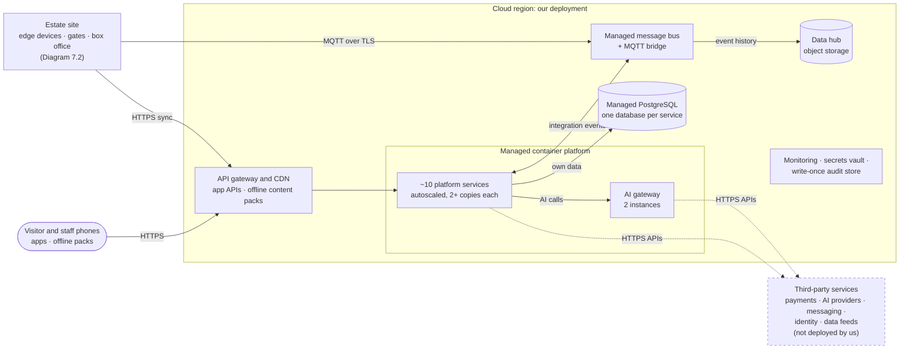
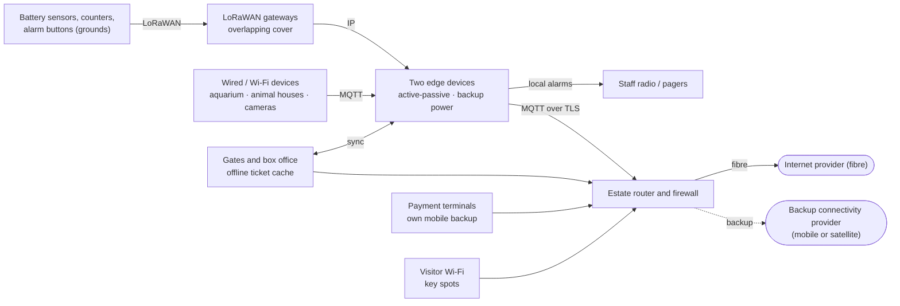
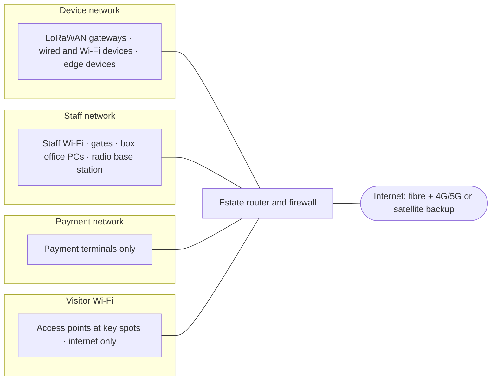

# 7. Deployment View

## 7.1 Overview

**Diagram 7.1 · Deployment view: where the Estate Platform runs**

*Key: the grouped box is our cloud deployment, one region chosen as a setting and spread over two availability zones; cylinders are data stores; rounded box is people's devices; the dashed box is third-party services we call but don't run (named by role, not vendor); dotted arrows are calls to them; arrow labels give what flows. Monitoring, secrets and the audit store serve every node. Inside the estate site, including internet and backup providers: Diagram 7.2. Network separation: Diagram 7.3. Full provider list: [section 3.4](03-context-and-scope.md#34-external-providers).*

| Node | Runs | Sized for | Failure handling |
|---|---|---|---|
| Visitor phones | Native apps, web app, offline content packs | — | App core works offline |
| Staff phones and tablets | Keeper and operations apps | — | Offline, sync later |
| LoRaWAN gateways | Radio reception, forward to edge devices | Overlapping coverage of all enclosures and zones | A sensor is heard by more than one gateway |
| Two edge devices | MQTT broker, LoRaWAN network server, local alarm rules, store-and-forward buffer, gate sync, own mobile modem for alarm SMS | ~550 devices; 72 h of buffered readings | Active-passive failover; backup power; managed remotely |
| Gates and box office | Scanning, offline ticket cache, on-site sales | Design day (lower end of 2–3× average), expanded in steps | Work offline, sync later |
| Payment terminals | Card payments | Peak days | Own mobile backup, then provider offline mode |
| Estate router and firewall | Internet link, network separation | All site traffic | Fibre plus 4G/5G or satellite backup |
| API gateway and CDN | App APIs, authentication, rate limits; offline content packs served close to visitors | Busiest-day app traffic and holiday on-sales | Managed; spread over two availability zones |
| Managed container platform | ~10 platform services and the AI gateway | Autoscaled; at least 2 copies of each service; AI gateway 2 instances | Unhealthy copies replaced automatically; site keeps working if the cloud is down |
| Managed PostgreSQL | One database per service | Grows with orders, records and accounts | Standby in a second availability zone; point-in-time backups |
| Managed message bus and MQTT bridge | Integration events between services; device messages from site | ~1 GB of sensor data a day at year 3 | Managed; site buffers 72 h if unreachable |
| Data hub (object storage) | Event history, checked figures, marked frames, photos | Full history | Replicated storage; open formats |
| Monitoring, secrets vault, audit store | Metrics, traces, provider keys, write-once audit trail ([section 8.9](08-crosscutting-concepts.md#89-audit-trail)) | — | Managed |

**Environments:** development, test and production in the cloud; a small **test kit on site** (spare edge device and a few sensors) to test alarm rules before release.

## 7.2 Estate site

**Diagram 7.2 · Deployment view: estate site devices, edge devices and connections**

*Key: boxes are devices or nodes on site; rounded boxes are external connectivity providers; arrow labels give the protocol. Everything on this diagram keeps working if the internet link drops; only the router's uplink stops.*

## 7.3 Network separation

**Diagram 7.3 · Deployment view: estate site network segmentation**

*Key: each group is a separate network segment; the router's firewall only allows the traffic listed below.*

| Segment | Can reach | Cannot reach |
|---|---|---|
| Device network | Edge devices; cloud MQTT bridge (outbound, encrypted); **radio base station, for alarm messages only** | Other staff systems, payment or visitor networks |
| Staff network | Platform in the cloud; edge devices for gate sync | Device management ports; payment network |
| Payment network | Payment provider only | Everything else (keeps card handling isolated) |
| Visitor Wi-Fi | Internet only | Every estate network |

## 7.4 Sizing and growth

| | Today | Year 1 | Year 2 | Year 3 |
|---|---|---|---|---|
| Visitors a day (average) | 5,000 | 8,500 | 12,000 | 15,000 |
| Visitors on the busiest days (2–3× average, assumed) | 10,000–15,000 | 17,000–25,500 | 24,000–36,000 | 30,000–45,000 |
| Visitors in the park at once (average day) | 3,000 | 5,100 | 7,200 | 9,000 |
| Devices (sensors, counters, cameras) | — | ~450 | ~500 | ~550 |
| Sensor data a day | — | ~0.8 GB | ~0.9 GB | ~1 GB |

Cloud services scale automatically (horizontal autoscaling). On-site parts (gates, entrance Wi-Fi, box office) are sized for a **design day** at the lower end of the busiest-day range and expanded in modular steps: on-site hardware moves to the next step early once peak visitors stay above about 80% of current capacity for four weeks. Operations measures (pre-booked timed arrival slots, temporary extra lanes) cover the busiest days. The brief's 15,000 a day is treated as the average.

## 7.5 Example technologies

The architecture names parts and providers by role ([section 3.4](03-context-and-scope.md#34-external-providers)). This table shows that every part can be built with products available today, and which **kind** of choice we made for each: build, open source, managed service or buy. The products are **examples, not commitments**. The technology provider selects them against the criteria in section 3.4.

| Part | Kind | Example products | Why this kind |
|---|---|---|---|
| Platform services | Build, in managed containers | Azure Container Apps, AWS ECS on Fargate, Google Cloud Run | Small IT team: no container cluster to run |
| Service databases | Managed | PostgreSQL as a managed service, with pgvector for companion content search | One familiar database type; search without a separate product |
| Message bus | Managed | Azure Service Bus, Amazon EventBridge with SQS, Google Pub/Sub | About 1 GB of sensor data a day doesn't need a streaming platform such as Kafka; revisit if replay at scale is needed |
| Cloud MQTT bridge | Managed | AWS IoT Core, Azure Event Grid MQTT broker, EMQX Cloud, HiveMQ Cloud | Standard MQTT; device certificates handled by the service |
| API gateway and CDN | Managed | Azure API Management with Front Door, Amazon API Gateway with CloudFront | Offline content packs served close to visitors |
| Data hub | Managed storage, open table format | Object storage with Apache Iceberg or Delta Lake tables; queried by Amazon Athena, BigQuery or DuckDB | Data stays in open formats we own, so it moves between clouds |
| Dashboards | Buy or open source | Power BI, Metabase; Grafana for operations | Standard reporting; checked figures defined once in the data hub |
| Edge devices | Buy | Industrial IoT gateways (e.g. Siemens SIMATIC IOT2050, Advantech) | Fan-less, remotely managed, rated for outdoor buildings |
| LoRaWAN network server and gateways | Open source; buy gateways | ChirpStack; outdoor gateways (e.g. Kerlink, MultiTech, Milesight) | Runs on our edge devices, no per-device fees |
| MQTT broker on site | Open source | Eclipse Mosquitto, EMQX | Proven, small, runs on both edge devices |
| Edge software updates | Managed | AWS IoT Greengrass, Azure IoT Edge, balena | Small team updates the site remotely |
| People counters | Buy | Counters that count inside the device (e.g. Xovis, Milesight) | Numbers only leave the device ([ADR-017](../adrs/ADR-017-privacy-by-design.md)) |
| Backup internet | Buy | 4G/5G router, or low-orbit satellite (e.g. Starlink) | Chosen after the site survey |
| Payments | Buy | Stripe, Adyen (terminals with their own mobile connection) | Card data never touches the platform ([ADR-004](../adrs/ADR-004-ticketing-build-payments-buy.md)) |
| Visitor and staff apps | Build | React Native or Flutter; web app as a progressive web app; SQLite for offline data | One code base for both phone platforms, with offline storage |
| Content management | Buy or open source | Strapi, Contentful | Content team edits approved answers and guides |
| Identity | Buy | Staff: Microsoft Entra ID or Google Workspace; visitors: Auth0, Amazon Cognito or Keycloak | Standard OpenID Connect |
| AI gateway | Open source | LiteLLM, Portkey | Portable routing, failover and budgets ([ADR-006](../adrs/ADR-006-ai-gateway.md)) |
| Generative AI | Managed | Anthropic Claude, OpenAI GPT, Google Gemini; directly or through Amazon Bedrock, Microsoft Foundry or Google's Gemini Enterprise Agent Platform | Primary and backup from different companies |
| Forecasting and anomaly detection | Managed, with open-source backup | Amazon SageMaker Canvas, BigQuery ML, Azure Machine Learning; backups: StatsForecast or Prophet (forecasts), PyOD (anomalies) | No model building ([ADR-013](../adrs/ADR-013-managed-ai-services.md)) |
| Piranha detection and food tray photos | Managed, with open-source backup | Amazon Rekognition Custom Labels, Google AutoML object detection; backup: a YOLO-family detector (licence checked) | Taught with a few hundred marked frames |
| Translation | Managed | DeepL, Google Cloud Translation, Azure AI Translator | Drafts approved by the content team |
| Staff assignment suggestions (later) | Open source | Google OR-Tools, Timefold | Configured solver, no scheduling licence |
| AI tracing and test sets | Open source | Langfuse (traces, sampled reviews), promptfoo (test sets in the release gate) | Same checks for every provider ([ADR-015](../adrs/ADR-015-validating-ai-results.md)) |
| Monitoring | Open source | OpenTelemetry, Grafana | One trace ID from app to AI provider |
| Secrets | Managed or open source | Cloud key vault, HashiCorp Vault | Provider keys held only by the gateway and services |
| Push, email and SMS | Buy | Firebase Cloud Messaging and Apple Push, Amazon SES, Twilio | Standard interfaces, easy to swap |
| Delivery | Open source and managed | OpenTofu or Terraform, GitHub Actions | Whole platform rebuilt from code in a new region or cloud |

**Why examples and not choices:** managed AI products come and go. Amazon Forecast closed to new customers in 2024, Amazon Lookout for Metrics ended in October 2025, Azure AI Anomaly Detector retires in October 2026, and Azure Custom Vision retires in September 2028 (so it isn't listed). Every managed AI product above therefore has an open-source backup, and our data stays in open formats.
