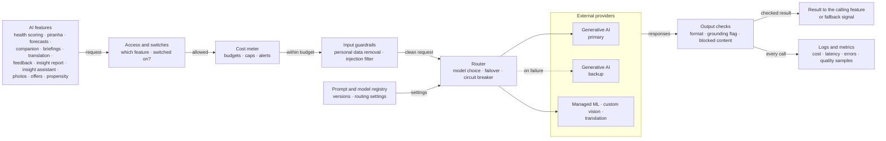
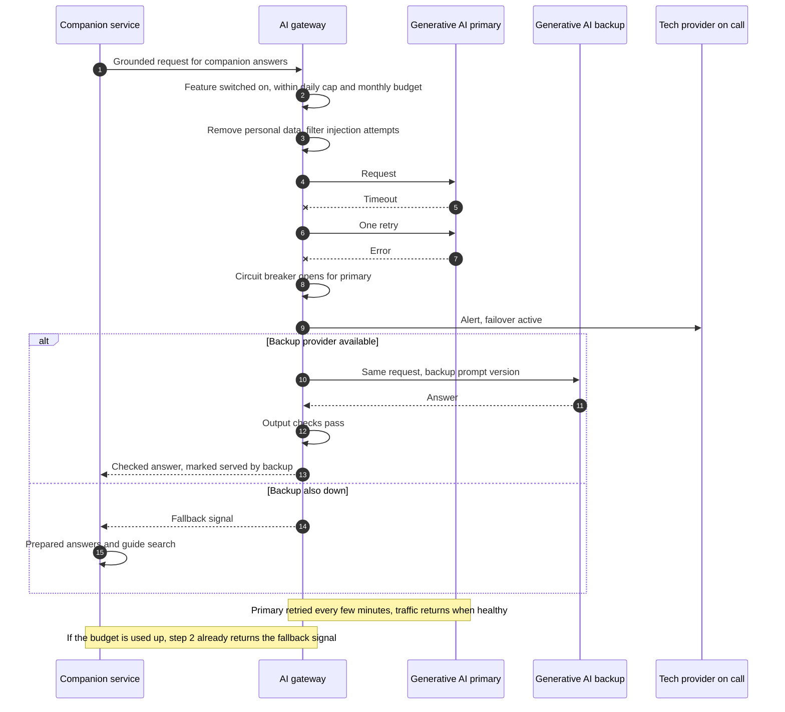

# AI Gateway and Fallback

Every AI call in the platform passes through one gateway. This document covers what all AI uses share: provider switching, cost control, guardrails, release checks and fallback. It is the main answer to the judging criterion "dealing with uncertainty in AI".

**Scope.** The gateway has two routes that share the same switches, budgets, logs and versions: a **request proxy** for generative AI and translation calls, and a **batch job runner** in the data hub for machine learning and vision jobs (scoring, forecasting, training, fish detection). Managed products can be withdrawn (Amazon Forecast closed to new customers in 2024; Azure AI Anomaly Detector retires in October 2026), which is why every machine learning feature has a portable backup.

## Key decisions

| Decision area | Options considered | Decision |
|---|---|---|
| How we get the gateway | Build our own · configure an open-source AI gateway in our cloud · use a cloud provider's own AI gateway | **Open-source AI gateway in our cloud**, extended with our policies. A cloud provider's own gateway ties us to that cloud; building from scratch isn't worth it |
| Backup provider readiness | Hot: connected, tested, taking a small share of traffic · warm: connected and tested monthly | **Hot standby for the companion** (visitors notice outages, and about 5% of traffic keeps the backup proven) · **warm standby for nightly features** (a delay of hours is fine) |
| When to switch provider | Automatic on errors · automatic on price or quality · manual after tests | **Automatic failover on errors and timeouts.** Changes for quality or price are **manual**, after the test set passes |
| Cost limits | Alerts only · hard stop | **Monthly token budget per feature** (FinOps), alerts at **80%**, **hard stop** at 100% → feature falls back to its day-one version. **Animal-care features** alert the head keeper and finance at 100% instead of stopping, because a missed illness costs more |
| Logs | Full prompts and answers kept · personal data removed, short retention | **Personal data removed, prompts and answers kept 30 days**; cost and quality metrics kept 13 months |

## Industry comparison

*A design check against common open-source and cloud AI gateway products (for example LiteLLM, Portkey, Kong AI Gateway, Cloudflare AI Gateway, Azure API Management, Amazon Bedrock). Not a vendor choice: the product is picked by the technology provider against the policies below.*

Our design matched these products on multi-provider access, fallback, budgets and guardrails, and goes further with a non-AI fallback per feature and cloud portability. The following were added to close the gaps:

| Addition | Decision |
|---|---|
| Rate limiting | Limits per feature, per visitor and per minute, measured in tokens; protects budgets on peak days and against abuse |
| Provider key management | Provider keys held only by the gateway, stored in a secrets vault, rotated regularly; features never see keys |
| Response caching | **Exact-match cache for content-only companion answers**, cleared whenever content is published. No caching by meaning (a near-match could return a wrong answer). Never cache answers with live facts or personal data |
| No streaming | Companion answers are shown only after output and grounding checks pass, within the 5-second response target; the app shows a 'thinking' state meanwhile |
| Tracing | One trace ID from app → companion → gateway → provider, to find where slow or wrong answers went wrong |

## What goes through the gateway

**Every** call from our features to an AI provider or managed AI service. No feature calls a provider directly.

| Feature | Service type | Primary | Backup | Fallback without AI |
|---|---|---|---|---|
| Animal health warnings | Managed machine learning | Managed ML provider | Open-source anomaly detection run as a batch job by the technology provider (warm) | Keeper rules |
| Keeper briefing | Generative AI | Generative AI primary | Generative AI backup (warm) | Plain list of flags |
| Piranha estimate | Custom vision | Custom vision provider | Detection model retrained on another service or open source, from our marked frames (warm) | Keeper counts and event log |
| Demand forecast | Managed machine learning | Managed ML provider | Open-source forecasting library run as a batch job by the technology provider (warm) | Calendar and booking-pace rules |
| Companion answers | Generative AI | Generative AI primary | Generative AI backup (**hot**) | Prepared answers and guide search |
| Food tray estimate (pilot) | Custom vision | Custom vision provider | Segmentation model retrained on another service from our labelled photos (warm) | Keeper-entered leftovers |
| Visible change check (year 2 pilot) | Image embeddings | Custom vision provider | Open-source image embedding model (warm) | Keeper observations |
| Offer text drafts | Generative AI | Generative AI primary | Generative AI backup (warm) | Standard seasonal messages |
| Return-visit propensity (later) | Managed machine learning | Managed ML provider | Open-source classifier run as a batch job (warm) | Rule-based segments |
| Content translation | Translation | Translation provider | Generative AI provider | Existing approved translations |
| Feedback insight | Generative AI | Generative AI primary | Generative AI backup (warm) | Ratings only |
| Monthly insight report | Generative AI | Generative AI primary | Generative AI backup (warm) | Dashboards only |
| Management insight assistant | Generative AI with tools | Generative AI primary | Generative AI backup (warm) | Dashboards and monthly report |

**Model routing** (LLM routing): simple requests (e.g. short factual questions) go to a smaller, cheaper model; complex ones to a larger model. Rules live in the gateway's settings.

## Diagram

**Diagram 5.2 · Building block view, level 2: AI gateway**

*Key: boxes are parts of the gateway; the grouped box is external providers; dotted arrow = used only on failure. Every call passes access, cost and input checks before a provider and output checks after.*

## Runtime scenario

**Diagram 6.8 · Runtime view: primary AI provider fails during a companion question**

*Key: numbered steps in time order; dashed arrows are replies; a cross means the call failed; "alt" shows the backup answering or, if it is also down, the fallback.*

## The three uncertainty questions from the brief

| Question in the brief | Our answer |
|---|---|
| "The best models or providers today might not be the best tomorrow" | Prompts, test sets and training data are ours. A new model is added in the registry, runs the feature's test set, then takes a small share of traffic before switching fully. No app release |
| "How would you handle your model provider changing prices on you?" | Cost meter shows the impact immediately; model routing moves simple requests to cheaper models; budgets hard-stop to the day-one version; switch provider after tests if needed |
| "What might happen if the provider you used suddenly shut down?" | Companion fails over to the hot backup in seconds; nightly features switch to their warm backup or run on their day-one version. **The estate keeps running with no AI at all** |

## Guardrails

| Stage | Check |
|---|---|
| Before a call | Feature switched on · within budget and rate limits · cache checked (content-only answers) · personal details removed (PII redaction: names, emails, phone numbers, children's details) · prompt-injection patterns filtered |
| After a call | Expected format (structured outputs validated) · grounding flag for companion answers · blocked content · response time recorded |
| Always | Provider contracts: no training on our data; hosting region set by us |

Safety routing to fixed answers happens **before** the gateway, in the companion service (keyword lists plus a small matching model hosted there), so safety questions never reach a provider.

## Release gate for AI changes

| Change | Required before going live |
|---|---|
| New model or provider | Feature's test set passes (e.g. companion 95%, safety routing 100%); then about 5% of traffic (canary release), watched for a week |
| New prompt version | Same test set |
| New trained model (forecast, anomaly detection, piranha) | Beats the current version on the held-back data; shadow period as defined for each AI use |
| New embedding model (companion search, safety matching, visible change check) | Content and examples re-embedded; full test set and **100%** safety test set pass |
| Threshold change | Re-run against recent history; owner signs off (head keeper, operations manager, content team) |

Every prompt, model version and routing setting is **versioned in the registry**, so any change can be rolled back in minutes.

## Monitoring

| Signal | Threshold | Who acts |
|---|---|---|
| Provider errors and timeouts | Failover triggered | Tech provider on call |
| Share of traffic on backup or fallback | Above **10%** for a day | Tech provider |
| Cost per feature | **80%** of monthly budget | Tech provider, estate finance |
| Response time (p95 latency) | Slowest 5% above **5 s** (companion) | Tech provider |
| Quality signals of each AI use | As defined in each AI use document | Feature owners |
| Personal data found in logs (sampled) | **Any** | Tech provider, data protection lead |

## Failure behaviour

| Failure | Behaviour |
|---|---|
| Primary provider down | Companion: backup within seconds. Nightly features: retry, then backup or day-one version |
| Gateway itself down | Features use their day-one version; runs as at least two instances to avoid this |
| Estate internet down | Doesn't affect the gateway (cloud); on-site features already work without it |

## Fit with the platform

| Quality | How the gateway serves it |
|---|---|
| Works offline | Not needed on site; every AI feature has a non-AI version |
| Easy to change | Providers, models, prompts and routing are settings, versioned and testable |
| Cheap to run | One place for budgets, caps and cheaper-model routing |

## Alternatives rejected

| Alternative | Why rejected |
|---|---|
| Caching answers by meaning (semantic cache) | A near-match can return the wrong answer; exact match only |
| Features calling providers directly | Switching needs code changes in every feature; no central cost or privacy control |
| A cloud provider's own AI gateway | Ties the AI layer to one cloud |
| Building a gateway from scratch | Open-source gateways already do routing and failover |
| Automatic switching on price or quality | Untested models could harm answer quality or safety |
| One provider only | No answer to the provider-shutdown question |

Decision records: [ADR-006 · AI gateway](../../adrs/ADR-006-ai-gateway.md) · [ADR-007 · Graceful degradation](../../adrs/ADR-007-graceful-degradation.md) · [ADR-013 · Managed AI services](../../adrs/ADR-013-managed-ai-services.md)

## Risks and assumptions

| Risk or assumption | Mitigation |
|---|---|
| Backup model answers differently from the primary | Separate prompt version per provider; the test set must pass on both |
| Personal data removal misses something in free text | Provider contracts are the firm control; sampled log checks |
| Gateway adds delay | Runs close to the services; response time monitored |
| Open-source gateway project stops being maintained (assumption: an active project is chosen) | It sits behind our own interface; can be replaced |
