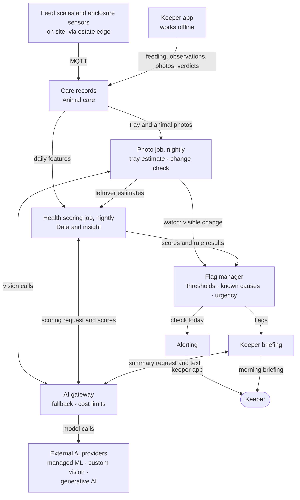
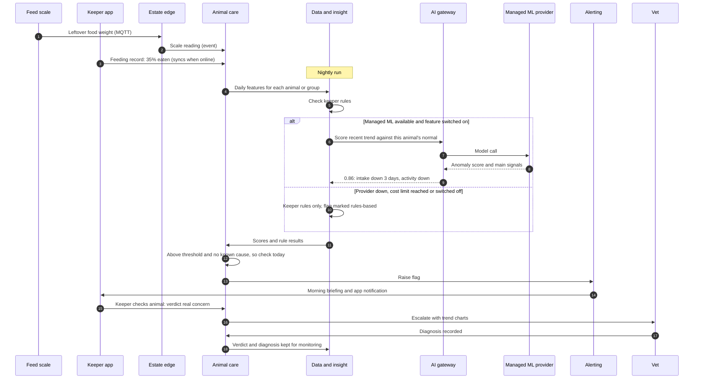

# Animal Health Warnings

Flags early changes in each animal's or group's eating, weight and activity, so keepers check before illness escalates. Keepers confirm every flag.

## Key decisions

| Decision area | Options considered | Decision |
|---|---|---|
| How health changes are detected | Keeper rules only · compare with each animal's normal (statistics) · combined-signal model (managed machine learning) · illness prediction trained on past cases · generative AI judging health | **Staged:** keeper rules (day one) → each animal's normal (after 4–8 weeks) → combined-signal model (after a season). Illness prediction later, once enough vet-confirmed cases exist. Generative AI judging health rejected |
| When it runs | Real time · after each feeding sync · nightly | **Nightly**, plus a simple intake check in the keeper app at the moment of recording |
| Highest urgency AI can raise | Urgent · check today · watch | **Check today.** Urgent alarms come only from rules (e.g. water quality) and keepers |
| Normal readings before opening | None · 4–8 weeks · a full season | **4–8 weeks** of readings before the collection opens to visitors |
| How flag noise is limited | False alerts per keeper per week · share of flags that are real concerns, plus an estate-wide workload cap | **At least 1 in 3 flags confirmed** as a real concern, with **about 6–10 flags a week** expected across the estate and a cap of **15**, once past the shadow period. A per-keeper count was rejected: it depends on rotas and group sizes, and with ~20 keepers it would allow far more false flags than real concerns |

## 1. Problem and goal

| | |
|---|---|
| Brief need | "Tracking animal health, how much/well they are eating" · "Looking after the animals is costly, even more so if they get sick" |
| Goal | Flag changes in an animal's or group's condition early, so keepers and the vet act before illness escalates |
| Targets | Recall on vet-confirmed illnesses, flag precision, flag volume and review time; target values in [section 10.3](../10-quality-requirements.md#103-ai-quality-targets) |

## 2. Users and scenario

| User | Gets |
|---|---|
| Keepers | Morning list of animals to check, with the reason and trend chart |
| Head keeper | Weekly view of flags, verdicts and missed cases |
| Vet | Escalated cases with history attached |

**Example:** a monitor lizard eats 35% less for three days and moves less. The keeper hasn't noticed because the drop is gradual. The next morning's list says "check today: intake down 3 days, activity down".

## 3. Data

| Signal | Source | Frequency | Per |
|---|---|---|---|
| Food given and left over | Feed scales; keeper app; before-and-after tray photos where scales don't fit (from year 1, pilot enclosures) | Each feeding | Animal or group |
| Photos of animals | Keeper app, attached to observations | Each observation, from day one | Animal |
| Body weight | Scales, where the species allows | Weekly to monthly | Animal |
| Activity | Motion sensors or cameras' built-in motion data | Hourly summary | Animal or enclosure |
| Environment: air, water quality | Enclosure sensors | Every minute | Enclosure |
| Keeper observations | Keeper app form: appetite, behaviour, visible issues | Each round | Animal or group |
| Vet diagnoses and treatments | Vet records | Each case | Animal |
| Known causes: breeding, moulting, treatment, weather | Keeper app, vet records, weather provider | As they happen | Animal or enclosure |

**Monitoring unit:** per animal where it can be identified; otherwise per group or enclosure.
**Day one:** almost no history. Readings collected for 4–8 weeks before opening.

## 4. AI approach

| Stage | Method (formal name) | When | Where it runs |
|---|---|---|---|
| Day one | Rule-based thresholds set by keepers (not AI) | From installation | Keeper app (at recording) and nightly job |
| Stage 2 | **Unsupervised time-series anomaly detection** against each animal's or group's own baseline, adjusted for season and environment (e.g. seasonal decomposition with robust z-scores) | After 4–8 weeks of readings | Nightly batch in the cloud |
| Stage 3 | **Unsupervised multivariate anomaly detection** combining intake, weight trend, activity and environment (e.g. isolation forest), with the main contributing signals shown (**feature attribution**) | After about one season | Managed machine learning provider, via the AI gateway |
| Later | **Supervised illness risk prediction** (binary classification trained on vet-confirmed cases) | Only when enough vet-confirmed cases exist | Same |
| Photo stage 1 | **Image segmentation** (supervised computer vision) of before-and-after tray photos to estimate food left over, feeding the intake signal; no new flag type | Year 1, pilot enclosures where scales don't fit | Managed vision service, via the AI gateway |
| Photo stage 2 | **Image similarity and change detection** against the same animal's earlier photos (skin, wounds, body condition); raises "watch" at most | Year 2, a few pilot species | Same |
| Supporting | **LLM summarisation** of flags into a keeper briefing, grounded in the flag data with each point linked to it (generative AI, not in the decision path) | From stage 2 | Generative AI provider, via the AI gateway |

**We don't build models.** The managed machine learning service trains on our data; we choose the signals, set thresholds and validate results.

## 5. Human role

| Level | What |
|---|---|
| Automatic | Compute scores · raise "watch" and "check today" flags · build the briefing · attach trend charts |
| Keeper confirms (human-in-the-loop) | Whether a flag is a real concern · escalation to the vet |
| Never AI | Diagnosis · changing feeding or medication · raising "urgent" |

**Confidence threshold:** a score threshold per species or group, tuned so flags stay within these targets. It starts low during the shadow period (more flags) and is tightened on evidence.
**Known causes** (breeding, moulting, treatment, cold weather) suppress or downgrade flags, and the keeper sees why.

## 6. Targeted AI diagram

**Diagram 5.4 · Building block view, level 3: animal health warnings**

*Key: boxes are building blocks or services; rounded box is a person; arrow labels say what flows. Generative AI only writes the briefing; it never decides a flag. The photo job runs only in pilot enclosures and species ([ADR-022](../../adrs/ADR-022-phone-photos-in-animal-care.md)): tray estimates feed scoring, and visible changes raise "watch" at most.*

## 7. Runtime scenario

**Diagram 6.4 · Runtime view: a health warning from feeding record to vet diagnosis**

*Key: numbered steps in time order; dashed arrows are replies; the "alt" box shows behaviour when AI is unavailable.*

## 8. Checks before release

| Check | Pass mark |
|---|---|
| Shadow period (shadow deployment): runs for 8–12 weeks without alerting; results compared with keeper observations and vet records | Head keeper and vet sign off |
| Injected test cases (synthetic anomaly injection): realistic changes (e.g. intake down 30% for 2 days) added to copies of real data | At least **90%** detected (recall on injected cases) |
| Flags on shadow data | At least **1 in 3** match a keeper or vet concern; no more than **15 a week** across the estate |
| Tray photo estimates (stage 1) | Within **±10%** of weighed leftovers on at least **8 of 10** test trays; shadow period before use in scoring |
| Fixed test set re-run before any new model version or threshold change, plus 2 weeks of shadow running | No worse than the current version |

## 9. Monitoring in production

| Signal | Threshold | Who acts |
|---|---|---|
| Share of flags keepers mark "not a concern" (1 − precision) | More than **2 in 3** over 2 weeks → too noisy (precision below target) | Head keeper with tech provider: raise threshold |
| Vet-confirmed illness with no earlier flag | Every case reviewed | Head keeper and vet, monthly |
| Flags across the estate per week | Above **15** for 2 weeks | Head keeper |
| Missing inputs (no feed record, faulty sensor) | Any flagged animal with missing data | Keeper; faulty sensor detection |
| Score distribution shifts (data drift, e.g. season change) | Noticeable shift month on month | Tech provider, monthly model review |
| Flags unreviewed after 24 h | Any | Head keeper |

## 10. Fallback and off switch

| Situation | Behaviour |
|---|---|
| Managed machine learning unavailable, or feature switched off (reaching the budget alerts the head keeper and finance instead) | Keeper rules only; flags marked "rules-based" |
| Generative AI unavailable | Briefing becomes a plain list of flags |
| Inputs missing for an animal | Shows "not enough data" instead of silently scoring |
| Off switch | Per species, per enclosure or for all animals |

## 11. Offline and failure behaviour

| Failure | Behaviour |
|---|---|
| No signal where the keeper is | App records offline; the simple intake check still runs in the app |
| Estate internet down | Readings buffered on site; scoring runs when data arrives. Health changes develop over days, so a delay is acceptable |
| Urgent environment problems (e.g. water oxygen) | Not part of this feature: handled by on-site alarm rules, which work without internet |

## 12. Provider changes and price rises

| Risk | Answer |
|---|---|
| Better model or provider appears | All readings and verdicts live in our data hub; retrain elsewhere and compare in shadow before switching |
| Provider raises prices | Nightly batch keeps usage small; reaching the budget alerts the head keeper and finance, who decide; the feature is not stopped automatically |
| Provider shuts down | Rules-only operation continues; thresholds, known causes and urgency logic stay in our flag manager, not the provider |

## 13. Privacy and safety

| Topic | Position |
|---|---|
| Personal data | None about visitors. Keeper names on observations are staff data with role-based access |
| Safety | AI never diagnoses or changes care; keepers and the vet decide |
| Records | Flags, verdicts and diagnoses kept as a welfare audit trail for regulators |

## 14. Rough cost (year 3)

| Item | Yearly range |
|---|---|
| Managed machine learning: weekly training, nightly scoring for ~200 animals and groups | ~€2K–8K |
| Keeper briefings: ~20 keepers, 2 a day | Under €1K |
| Photo features (pilot): tray estimates and change checks | Under €2K |
| Hardware (feed scales, motion sensors) | Capital cost, sized in the device plan; not AI running cost |

## 15. Fit with the platform

| Quality | How this feature matches it |
|---|---|
| Works offline | Data captured offline; scoring can wait because health changes develop over days; urgent issues use on-site rules |
| Easy to change | Rules, thresholds and known causes are settings; the model sits behind a managed service and the AI gateway; switchable per species |
| Cheap to run | Nightly batch; no on-site AI; small data volumes |
| Animal care area: accurate records, safety | Every flag and verdict audited; keepers confirm |

## 16. Alternatives rejected

| Alternative | Why rejected |
|---|---|
| Generative AI judging health from data or images | Can be confidently wrong; hard to validate; unsafe for welfare decisions |
| Real-time streaming detection | Health changes over days; adds cost for no benefit |
| AI running on site | Fails the test for AI hardware on site (see [ADR-005](../../adrs/ADR-005-cloud-first-ai.md)) |
| Illness prediction from day one | No labelled illness cases yet |
| Wearable sensors on animals | Stress for animals; impractical for aquatic and venomous species |
| Behaviour analysis from fixed camera clips | Deferred: high cost and labelling effort ([ADR-014](../../adrs/ADR-014-camera-behaviour-analysis-deferred.md)); phone photos staged instead ([ADR-022](../../adrs/ADR-022-phone-photos-in-animal-care.md)) |
| Automatic escalation to the vet | False alarms waste vet time; the keeper confirms first |

Decision record: [ADR-009 · Animal health warnings](../../adrs/ADR-009-animal-health-warnings.md)

## 17. Risks and assumptions

| Risk or assumption | Mitigation |
|---|---|
| Keepers record observations reliably (assumption) | Two-tap form built into rounds; show keepers the value (flags they agreed with) |
| Group-housed animals hide individual illness | Per-group monitoring is less sensitive; keeper observation remains primary |
| Feed scales practical in every enclosure (assumption) | Keeper-entered leftovers or tray photo estimates where scales don't fit |
| Many species with few animals each | Conservative statistics; thresholds per species group |
| Alert fatigue | Flag quality target, estate-wide workload cap and noise monitoring |
| About 3–5 real concerns a week across 200+ animals (assumption): at 70% recall about 3 are flagged, so 1 in 3 precision means about 6–10 flags a week | Targets reviewed after the shadow period against actual keeper and vet cases |
| Seasonal or breeding changes mistaken for illness | Known-cause records, season and environment adjustments |
| Photo estimates unreliable for some species or foods | Pilot species only; shadow period; off per species ([ADR-022](../../adrs/ADR-022-phone-photos-in-animal-care.md)) |
| Few illness cases, so the 70% target is slow to measure | Injected test cases plus monthly vet review of every case |
