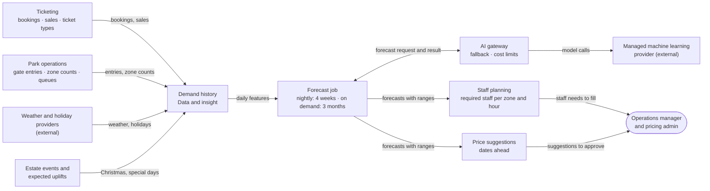
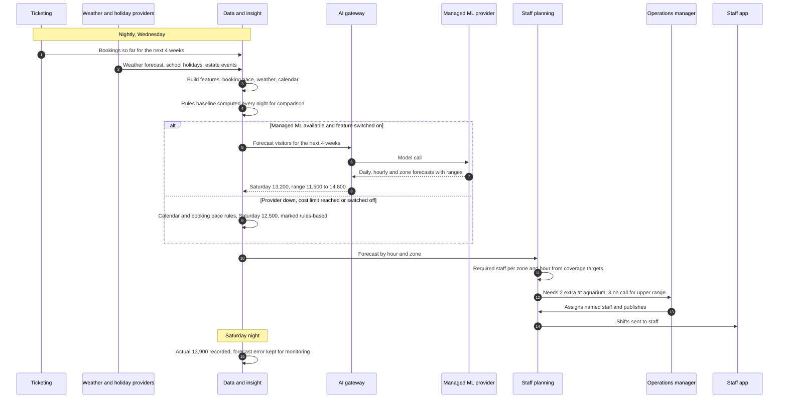

# Demand Forecast and Staff Planning

Forecasts visitors 4 weeks ahead every night (up to 3 months on demand) and turns the forecast into required staff per zone and hour, for managers to assign.

## Key decisions

| Decision area | Options considered | Decision |
|---|---|---|
| What is forecast | 14 days · 4 weeks · 12 months | **Nightly: next 4 weeks** (daily visitors and visitor mix; hourly by zone for the first 7 days). **On demand: up to 3 months ahead** (daily and weekly totals, wider ranges), e.g. to plan Christmas |
| Forecast method | Calendar averages · industry-standard time-series forecasting with calendar, event, booking-pace and weather inputs · custom deep learning · generative AI | **Industry practice, staged:** seasonal forecast with holidays and estate events (management enters expected uplifts, e.g. Christmas, in year 1) → adjusted by **booking pace** for the coming weeks → adjusted by **weather** for the coming days. Rules on day one; managed time-series forecasting after about 3 months; learns events from real history after the first year. Deep learning and generative AI rejected |
| How the staff plan is produced | Staff numbers only · numbers plus assignment suggestions · buy staff scheduling software | **Staged:** Start with **required staff per zone and hour** in our own staff planning module; managers assign named staff. Add assignment suggestions later using an open-source constraint solver, if managers want it. Buying staff scheduling software rejected |
| Who publishes the plan | Automatic · manager approves | **Manager approves and publishes.** Never automatic |
| Update timing | Nightly · nightly plus morning update · continuously | **Nightly**, plus an early-morning update using that day's bookings and weather. Live crowd levels during the day stay rules-based (non-AI) |

## 1. Problem and goal

| | |
|---|---|
| Brief need | "We have no real idea of what parts of the estates are most popular, so it's difficult to know where to invest & deploy staff" · "more profitable" |
| Goal | Put the right number of staff in the right zones at the right times, and plan ahead for busy and quiet days |
| Targets | Forecast error, hours with long queues and staff hours per 1,000 visitors; target values in [section 10.3](../10-quality-requirements.md#103-ai-quality-targets) |

## 2. Users and scenario

| User | Gets |
|---|---|
| Operations manager | Required staff per zone and hour, with expected visitors and a range; assigns named staff |
| Zone supervisors | Where extra help is expected and why |
| Pricing admin | Price suggestions for quieter or busier dates weeks ahead (included feature, approval required) |
| Staff | Published shifts in the staff app |

**Example:** on Wednesday night, rain is forecast for Saturday and bookings are ahead of pace. The forecast says 13,200 (range 11,500–14,800), with more visitors indoors at the aquarium. Staff planning shows 2 extra needed at the aquarium and 3 on call for the upper range. The manager assigns named staff and publishes.

## 3. Data

| Data | Source | Frequency |
|---|---|---|
| Bookings and sales by date, ticket type, channel | Ticketing | Continuous |
| Gate entries by time | Entry | Continuous |
| Zone counts, queue lengths, ride boardings | Park operations (sensors, counters) | Every minute, summarised hourly |
| Weather forecasts and actuals | Weather data provider | Hourly |
| School and public holidays | Holiday calendar provider | Daily |
| Estate schedule: feeding shows, ride closures, special days | Operations | As planned |
| Estate events and expected uplifts (e.g. Christmas +40% in year 1) | Management | When planned |
| Prices in force | Ticketing (pricing rules) | On change |
| Staff availability, skills, rosters | Staff planning module (Park operations) | Daily |

**Day one:** little history; calendar patterns and booking pace work from the first week.

## 4. AI approach

Follows common practice for attractions and hotels: a seasonal forecast with calendar and events, adjusted by advance bookings ("pickup" or booking pace), then by weather close to the day.

| Horizon | Detail | Method (formal name) | Main inputs |
|---|---|---|---|
| On demand: up to 3 months | Daily and weekly totals | **Probabilistic seasonal time-series forecasting** with calendar and event variables as **exogenous variables** (covariates) | Seasonality, holidays, estate events and uplifts, last year (from year 2), prices |
| Nightly: 1–4 weeks | Daily totals, visitor mix | Seasonal forecast combined with a **pickup (booking pace) model**, a revenue-management method used as a covariate | Bookings so far compared with the usual build-up |
| Nightly: 1–7 days | Hourly and by zone | **Time-series forecasting with weather covariates**, split consistently into hours and zones (**hierarchical forecasting with reconciliation**) | Weather forecast, zone patterns |

| Stage | What runs | Where |
|---|---|---|
| Day one | Calendar rules, management's event uplifts, booking pace (statistics, not AI) | Nightly job, Data and insight |
| After about 3 months | Managed time-series forecasting (**AutoML**: the service selects and ensembles model families such as exponential smoothing, ARIMA and gradient-boosted trees) for the nightly horizons, with **prediction intervals** | Managed machine learning provider, via the AI gateway |
| After the first year | Events and seasons learned from real history; fewer manual uplifts | Same |
| Staff plan | **Required staff per zone and hour** from forecasts and coverage targets (rules) | Staff planning module, Park operations |
| Later, if wanted | **Constraint-based scheduling optimisation** (constraint programming, an operations research method, not machine learning) suggesting who works where (open-source solver library, configured, not trained) | Staff planning module |
| Included | **Forecast-driven price suggestions** (rule-based, not AI): rules that map forecast busyness to a price band within admin-set minimum and maximum prices; checked by comparing visits and revenue on similar dates and small planned price tests | Nightly job; admin approves |

Coverage targets (staffing ratios, e.g. staff per 500 visitors in a zone, minimum crew per ride) are **settings owned by operations**, not learned by AI.

## 5. Human role

| Level | What |
|---|---|
| Automatic | Forecasts, ranges, required staff per zone and hour, notice when a forecast changes a lot |
| Manager confirms (human-in-the-loop) | Assigning named staff and publishing shifts · calling in on-call staff · applying price suggestions |
| Never AI | Publishing rotas automatically · contacting staff about contracts · judging individual staff performance |

**Uncertainty:** the plan covers the middle forecast. On days with a wide range, an on-call list covers the upper end instead of rostering everyone.

## 6. Targeted AI diagram

**Diagram 5.6 · Building block view, level 3: demand forecast and staff plan**

*Key: boxes are building blocks or services; rounded box is a person; arrow labels say what flows. "Staff planning" is our own module in Park operations.*

## 7. Runtime scenario

**Diagram 6.6 · Runtime view: nightly forecast to published staff plan**

*Key: numbered steps in time order; dashed arrows are replies; "alt" shows behaviour when AI is unavailable.*

## 8. Checks before release

| Check | Pass mark |
|---|---|
| Back-testing on history (**rolling-origin back-testing**: each past week forecast as if it were the future) | At least **15% lower error** (MAPE, mean absolute percentage error) than the calendar-rules baseline |
| Prediction ranges | Actual visitors inside the range on about **80%** of days (**prediction interval coverage**) |
| Shadow period (shadow deployment): 4–6 weeks, forecasts shown alongside managers' own plans | Operations manager signs off |
| Staff plans | Required staff never below minimum crews for rides and safety roles; coverage targets met when replayed against actual counts |

## 9. Monitoring in production

| Signal | Threshold | Who acts |
|---|---|---|
| Forecast error (MAPE), rolling 14 days | Above **20%** → review | Tech provider |
| Actuals outside the forecast range (interval coverage) | More than **20%** of days → ranges too narrow | Tech provider |
| Error compared with the rules baseline | AI no better for a month → investigate, or fall back | Tech provider |
| Hours with queues above target | Rising trend | Operations manager |
| Share of draft plan changed by managers | Above **40%** → plan not trusted; review coverage targets | Operations manager |
| Late or missing bookings or weather data | Any night | IT |

## 10. Fallback and off switch

| Situation | Behaviour |
|---|---|
| Managed forecasting unavailable, cost limit reached, or switched off | Calendar and booking-pace rules; forecast marked "rules-based" |
| Staff planning module unavailable | Last published shifts stay in the staff app; managers adjust manually |
| Off switch | Forecast feature, price suggestions, each separately |

The rules baseline runs **every night alongside the AI forecast**, so the fallback is always ready and the AI is always compared against it.

## 11. Offline and failure behaviour

| Failure | Behaviour |
|---|---|
| Estate internet down | Gate and zone counts buffered on site; the forecast uses the latest data received |
| Staff without signal | Published shifts cached in the staff app |
| Delay | Acceptable: plans are made days ahead |

## 12. Provider changes and price rises

| Risk | Answer |
|---|---|
| Better forecasting service appears | All history is in our data hub; train elsewhere and compare in back-tests before switching |
| Price rise | Nightly batch is small; cost limit falls back to rules |
| Provider shuts down | Rules baseline continues; coverage targets and the plan stay in our systems |
| Staff planning | Our own module; no scheduling vendor to depend on |

## 13. Privacy and safety

| Topic | Position |
|---|---|
| Visitor data | Aggregated counts and ticket types only; no individual tracking |
| Staff data | Availability and skills are personal data: role-based access; used for scheduling only |
| Fairness to staff | Managers assign shifts; labour rules and preferences apply when assignment suggestions are added later; AI never scores staff |
| Safety | Minimum crews for rides and safety roles are fixed rules the plan can't go below |

## 14. Rough cost (year 3)

| Item | Yearly range |
|---|---|
| Managed forecasting: weekly training, nightly forecasts | ~€2K–6K |
| Price suggestion job | Under €1K |
| Staff planning module | Part of platform build; no licence |

## 15. Fit with the platform

| Quality | How this feature matches it |
|---|---|
| Works offline | Batch planning days ahead; nothing on site depends on it; shifts cached on phones |
| Easy to change | Coverage targets and price limits are settings; forecasting service behind the AI gateway; baseline always available |
| Cheap to run | Nightly batch; simple staff-numbers module first, no scheduling licence |
| Ticketing and pricing area: accurate prices | Suggestions only; prices change only after admin approval and are locked per order |

## 16. Alternatives rejected

| Alternative | Why rejected |
|---|---|
| Generative AI producing forecasts | Poor at numerical forecasting; not repeatable |
| Custom deep learning models | We don't build models; too little data early on |
| Buying staff scheduling software | Another vendor and licence; staff data outside our platform; integration effort for a feature managers can start without |
| Full automatic assignment at launch | Labour rules, preferences and fairness disputes before managers trust the numbers; added later if wanted |
| Publishing rotas automatically | Staff and legal impact; manager approves |
| Continuous AI re-forecasting during the day | Live crowd levels are handled by rules; forecasts serve planning days ahead |
| Tracking individual visitors to forecast crowds | Privacy; aggregated counts are enough |

Decision record: [ADR-011 · Demand forecast and staff planning](../../adrs/ADR-011-demand-forecast-staff-planning.md)

## 17. Risks and assumptions

| Risk or assumption | Mitigation |
|---|---|
| Little history in the first months | Rules baseline; AI only replaces it once back-tests show it's better |
| Unusual events (heatwave, local festival) | Operations can add known events as forecast inputs |
| Ride closures shift crowds between zones | Closures are an input; zone forecasts refreshed each morning |
| Price changes influence demand, which influences price suggestions | Prices in force are a forecast input; suggestions limited to admin-set ranges |
| Managers don't trust the plan | Shadow period; each draft shows the forecast and range behind it |
| Managers keep assigning staff manually for now | Assignment suggestions added once the numbers are trusted |
