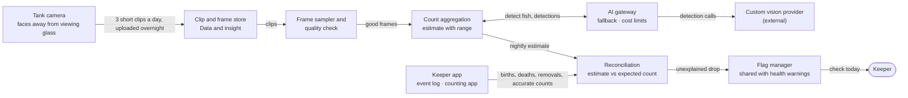
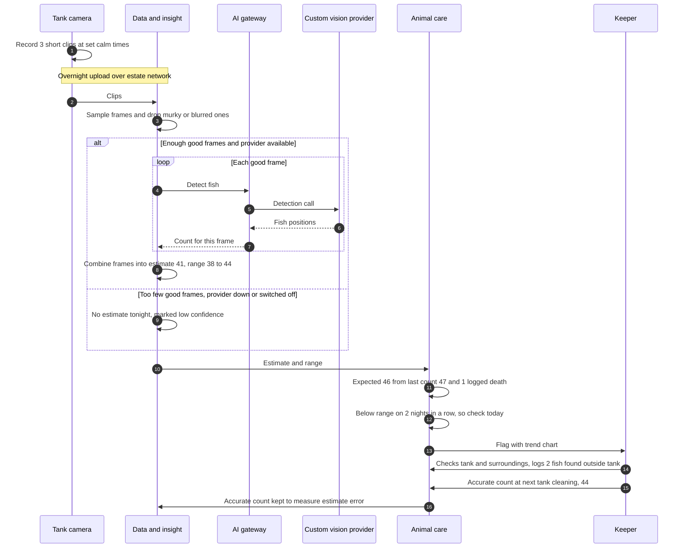

# Piranha Population Estimate

Estimates the jumping piranha population every night from short tank clips, with a range, and checks it against accurate counts and a log of births, deaths and removals.

## Key decisions

| Decision area | Options considered | Decision |
|---|---|---|
| Estimate method | Detect fish in many sampled frames and combine the counts · track each fish across video · keeper counts only | **Detect in sampled frames and combine.** Tracking across video deferred (fragile in murky water); keeper counts alone are too infrequent |
| Clips per day | One · three short clips at set calm times · continuous video | **Three short clips** at set calm times (e.g. before feeding) |
| Accurate count | Weekly netting and counting · counting app during planned tank maintenance · none | **Counting app during planned tank maintenance** (every 1–3 months, no extra handling of the fish), plus **monthly keeper counts from marked video clips** |
| When to flag | Any drop · drop below the estimate's range for two nights in a row · weekly review only | **Below range two nights in a row**, with no logged cause → "check today" |
| Keeping visitors out of frame | Camera angle away from the glass, checked at installation · automatic person detection that discards frames | **Camera angle**, checked at installation. Person detection adds AI for little gain |

## 1. Problem and goal

| | |
|---|---|
| Brief need | "In the case of the jumping piranha collection, we also need to check population levels" |
| Goal | Know daily whether the group is stable, growing or shrinking, and catch unexplained losses (deaths, fish eating each other, fish jumping out) within days |
| Targets | Estimate error, drop detection time and count frequency (assumption: ~40 fish); target values in [section 10.3](../10-quality-requirements.md#103-ai-quality-targets) |

## 2. Users and scenario

| User | Gets |
|---|---|
| Keepers | Nightly estimate with range and trend; flag when numbers don't add up |
| Head keeper and vet | Trend over months; link to deaths and breeding events |

**Example:** the last accurate count was 47 and one death was logged, so 46 are expected. For two nights the estimate is 41 (range 38–44). The keeper checks and finds two fish outside the tank.

## 3. Data

| Data | Source | Frequency |
|---|---|---|
| Short video clips | Camera facing into the display tank, away from the viewing glass | 3 clips a day, uploaded overnight |
| Marked frames (fish outlined), the training data | Keepers or tech provider, once at setup, then after tank changes | A few hundred frames |
| Accurate counts | Counting app on photos of fish in a holding container during planned tank maintenance | Every 1–3 months |
| Keeper counts from marked clips | Keepers mark every fish in a few selected frames | Monthly |
| Population events | Keeper app: births, deaths, removals, fish found outside the tank | As they happen |
| Water quality | Tank sensors (explains low-confidence nights) | Every minute |

**Day one:** keeper counts and the event log only, until the marked frames exist.

## 4. AI approach

| Stage | Method (formal name) | Where it runs |
|---|---|---|
| Day one | Keeper counts + event log (not AI) | Keeper app |
| Main | **Supervised computer vision: object detection**, fine-tuned with **transfer learning** (AutoML) on a few hundred labelled frames | Custom vision provider, via the AI gateway, nightly |
| Main | **Image quality assessment** (rules on blur, brightness and contrast): drop blurred, dark or murky frames before detection | Nightly job in Data and insight |
| Main | **Multi-frame count aggregation** (statistical estimation, e.g. robust median across frames): combine per-frame counts into an estimate with a **confidence interval** (range), adjusted for fish hidden behind decor by **calibration** against past accurate counts | Nightly job |
| Main | **Reconciliation** (deterministic rule, not AI): expected count = last accurate count + births − deaths − removals; flag unexplained gaps | Animal care |
| Later, if needed | **Multi-object tracking** across video | Same provider |

Training managed vision services on our own labelled images (piranha frames here, food tray photos in [ADR-022](../../adrs/ADR-022-phone-photos-in-animal-care.md)) is the **one exception** to "we don't build models": it's configuration of a managed service, not model building.

## 5. Human role

| Level | What |
|---|---|
| Automatic | Nightly estimate, range, trend chart; "check today" flag on an unexplained drop |
| Keeper confirms (human-in-the-loop) | Whether fish are really missing; logging events; doing accurate counts |
| Never AI | Removing or adding fish; changing feeding; raising urgent alarms |

**Confidence rule:** an estimate is published only when enough good-quality frames exist. A wide range or too few frames means "low confidence" and no flag.

## 6. Targeted AI diagram

**Diagram 5.5 · Building block view, level 3: piranha population estimate**

*Key: boxes are building blocks or services; rounded box is a person; arrow labels say what flows. The flag manager is shared with animal health warnings.*

## 7. Runtime scenario

**Diagram 6.5 · Runtime view: nightly piranha estimate to keeper check**

*Key: numbered steps in time order; dashed arrows are replies; "alt" shows behaviour when frames are poor or AI is unavailable; "loop" repeats for each frame.*

## 8. Checks before release

| Check | Pass mark |
|---|---|
| Held-back marked frames (not used for training) | Per-frame detections agree with markings on at least **90%** of fish (detection **precision and recall**) |
| 10 test clips marked by keepers (different days, lighting and water clarity) | Estimate within **±10%** of the keeper's count on at least **8 of 10** (counting error, absolute percentage error) |
| Four-week shadow period (shadow deployment): estimates shown to keepers without flags | Keepers agree the trend is plausible; any accurate count taken is within **±10%** |
| Test clips across lighting and water clarity | Low-quality clips marked "low confidence", not wrongly counted |
| After tank changes (new decor, lighting): re-mark a sample and re-test | Same pass marks before flags are switched back on |

## 9. Monitoring in production

| Signal | Threshold | Who acts |
|---|---|---|
| Estimate against monthly keeper clip counts | Outside **±10%** twice in a row → review (the earliest drift signal between accurate counts) | Tech provider |
| Estimate error against each accurate count (absolute percentage error) | Above **15%** twice in a row → retrain | Tech provider |
| Share of low-confidence nights | Above **30%** in a month → check camera or water | Keeper, IT |
| Range width | Widening trend | Tech provider |
| Flags marked "not a concern" | More than half in a month → review flag rule | Head keeper |

## 10. Fallback and off switch

| Situation | Behaviour |
|---|---|
| Vision provider unavailable, cost limit reached or switched off | No estimate; expected count from event log shown; keeper counts continue |
| Poor clips | "Low confidence", no flag |
| Off switch | Per tank |

## 11. Offline and failure behaviour

| Failure | Behaviour |
|---|---|
| Estate internet down | Camera keeps clips locally for several days; uploads when the link returns; estimates catch up |
| Delay | Acceptable: population changes are checked over days |
| Fish jumping out | Not an AI problem: physical tank cover, plus keepers logging fish found outside |

## 12. Provider changes and price rises

| Risk | Answer |
|---|---|
| Better service appears | Clips and marked frames are ours; retrain elsewhere and compare on the held-back frames before switching |
| Price rise | Fewer frames sampled per night; the cost limit stops estimates rather than overspending |
| Provider shuts down | Keeper counts and event log continue; retrain on another service or an open-source detection model |

## 13. Privacy and safety

| Topic | Position |
|---|---|
| Visitors in frame | Camera faces into the tank, away from the glass; checked at installation and after any camera move |
| Personal data | None |
| Staff safety | Accurate counts done within existing safe-handling procedures for piranhas |

## 14. Rough cost (year 3)

| Item | Yearly range |
|---|---|
| Detection calls (~150 frames a night) and occasional retraining | Under **€2K** |
| Clip storage | Negligible |
| Camera | Capital cost, in the device plan |

## 15. Fit with the platform

| Quality | How this feature matches it |
|---|---|
| Works offline | Clips buffered on the camera; nothing urgent depends on the link |
| Easy to change | Training data owned by us; service behind the AI gateway; rules (range, two nights) are settings |
| Cheap to run | Small nightly batch; no on-site AI |
| Animal care area: accurate records | Event log and accurate counts form an audit trail |

## 16. Alternatives rejected

| Alternative | Why rejected |
|---|---|
| Exact counting from video | Fish overlap, hide and move; exact numbers from video are unrealistic |
| Tracking each fish across video (now) | Fragile in murky water; possible later if accuracy demands it |
| Counting passage between tank sections | Needs a tank rebuild; resident fish swim back and forth |
| Specialist fish-farm counting systems | Built for large transfers between pens; overkill for one display tank |
| Keeper counts only | Monthly is too slow to catch losses |
| Continuous video to the cloud | Bandwidth and cost; no benefit over short clips |
| AI running on site | Fails the test for AI hardware on site (see [ADR-005](../../adrs/ADR-005-cloud-first-ai.md)) |

Decision record: [ADR-010 · Piranha population estimate](../../adrs/ADR-010-piranha-population-estimate.md)

## 17. Risks and assumptions

| Risk or assumption | Mitigation |
|---|---|
| About 40 fish in one or two tanks (assumption) | Camera count scales per tank |
| Fish hiding behind decor cause undercounting | Correction factor from past accurate counts |
| Murky water or reflections | Quality filtering; low-confidence nights don't flag |
| Very small young fish not detected | Tracked through the event log, not the camera |
| Accuracy drops after tank changes | Re-mark and re-test trigger |
| Marking a few hundred frames takes effort | One-off, roughly one to two days of work |
