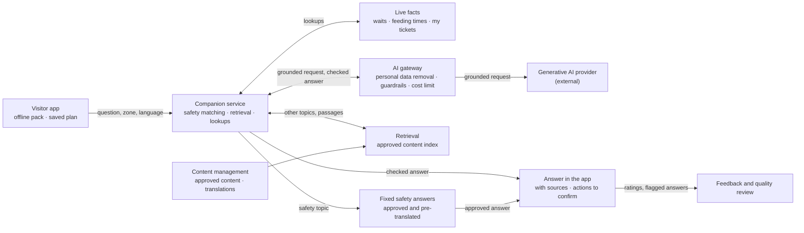
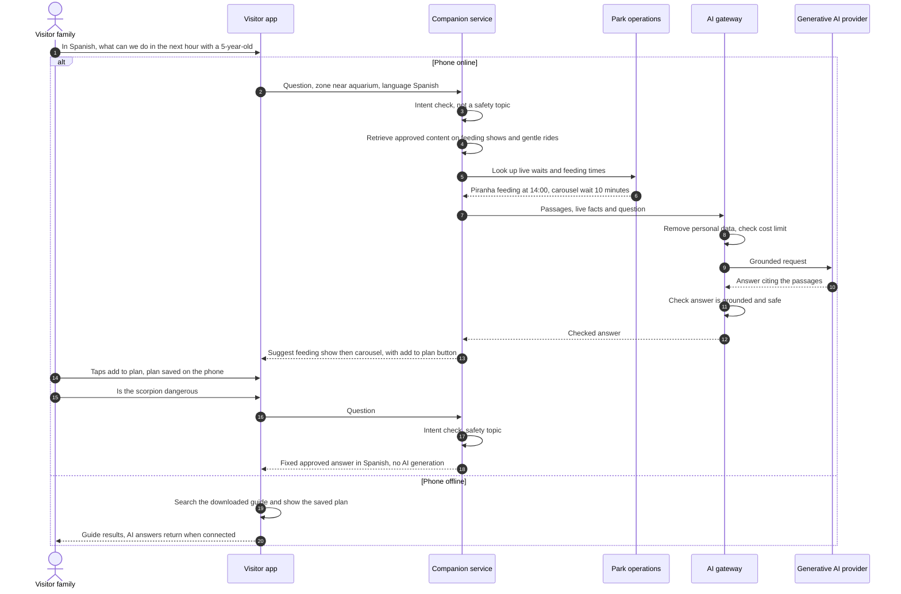

# Visitor Companion

Helps visitors plan their day and answers their questions in their language from approved estate content, with fixed safety answers and a core that works offline.

## Key decisions

| Decision area | Options considered | Decision |
|---|---|---|
| What it can answer | Approved estate content only · general knowledge too | **Approved estate content only**, plus live facts. Otherwise: "I'm not sure, please ask a member of staff", with the nearest help point |
| Safety topics | Generated with extra care · fixed approved answers | **Fixed approved answers, never generated.** An intent check runs before anything else; if unsure, it's treated as a safety topic |
| What it can do | Answer only · look things up · take actions | **Look things up** (waits, feeding times, map, my tickets) and **prepare actions** (add to plan, go to ticket checkout). The visitor confirms in normal app screens; payments never happen inside the chat |
| Offline | AI model on the phone · downloaded guide with search | **Downloaded guide with search** (not AI), saved day plan, map, last known waits with a timestamp |
| Languages | English only · a set of languages · any language | **A set chosen by admins** (e.g. 6). Content and safety answers pre-translated and checked by people; AI answers in the visitor's language |
| Conversation data | Stored on our servers · kept on the phone | **Kept on the phone.** Server logs have personal data removed and are kept **30 days** for quality review |
| Cost control | No limit · daily budget · daily budget plus a per-visitor cap | **A daily cap inside the monthly budget**, plus about 30 questions per visitor per day; above it, prepared answers only |

## 1. Problem and goal

| | |
|---|---|
| Brief need | AI that helps "the companies customers" · "grow the number of visitors" · "more returning visitors" |
| Goal | Help visitors plan and enjoy their day in their own language, avoid queues, and find answers, even where Wi-Fi is patchy |
| Targets | Adoption, helpfulness, safety routing, answers backed by content and queue time of plan followers; target values in [section 10.3](../10-quality-requirements.md#103-ai-quality-targets) |

## 2. Users and scenario

| User | Gets |
|---|---|
| Families | Plans that fit children's ages, feeding times and breaks |
| Tourists | Answers and content in their language |
| Visitors with accessibility needs | Step-free routes, quieter times, facilities |
| Repeat visitors | What's new since their last visit |
| Content team | List of questions the companion couldn't answer (content gaps) |

**Example:** a Spanish family asks, "What can we do in the next hour with a 5-year-old?" The companion checks feeding times and live waits, then suggests the piranha feeding at 14:00 followed by the carousel (10-minute wait), with an "add to plan" button. Later they ask, "Is the scorpion dangerous?" That gets a fixed, approved answer in Spanish, with no AI generation.

## 3. Data

| Data | Source | Freshness |
|---|---|---|
| Approved content: animals, rides and their history, facilities, rules, accessibility | Content management | On publish |
| Fixed safety answers, in each language | Content team, checked by keepers and safety lead | On publish |
| Schedules: feeding shows, talks, opening hours, closures | Park operations, Animal care | Daily, or on change |
| Live waits and zone crowd levels | Park operations | Every minute (when online) |
| Quieter-time forecasts | [Demand forecast](demand-forecast-staffing.md) | Nightly |
| The visitor's own tickets and passes | Ticketing (signed-in visitors only) | Live |
| Preferences, saved plan, conversation | The visitor's phone only | — |
| Location as a zone | Phone, with consent | When asked |
| Ratings and flagged answers | App | Each answer |

**Offline content pack:** guide, map, schedules, **fixed safety answers and nearest help points**; downloaded at home or on visitor Wi-Fi at the entrance.

## 4. AI approach

| Part | Method (formal name) | Where it runs |
|---|---|---|
| Safety routing | **Intent classification** for safety topics: keyword rules plus **embedding similarity** to approved safety questions in each supported language, using a small pre-trained multilingual embedding model hosted inside the companion service, with **no call to an AI provider**; **fail-safe threshold**: uncertain means safety | Companion service (cloud) |
| Answers | **Retrieval-augmented generation (RAG)** over approved content, using **hybrid retrieval** (keyword search plus **semantic search over embeddings**), with **source citations** | Retrieval in companion service; generation by generative AI provider via the AI gateway |
| Live facts | **Bounded tool use (LLM function calling)**: read-only lookups; actions only prepared for the visitor to confirm | Companion service |
| Checks on answers | **Input and output guardrails**: personal data removal, prompt-injection filtering, **grounding check** (groundedness evaluation: answer must be supported by retrieved sources), blocked topics | AI gateway |
| Day plan | **LLM structured output** to capture preferences, then **constraint-based route scheduling** (constraint programming, not generative AI) to order visits around times, waits and breaks | Companion service |
| Translation | **Neural machine translation** of content, reviewed by people before publishing | Translation provider via the AI gateway |
| Offline | **Keyword search** over the downloaded guide (not AI) | Phone |
| Cost control | **LLM routing**: simple questions to a smaller model, complex ones to a larger model | AI gateway |

| Stage | What visitors get |
|---|---|
| Day one | Offline guide, map, search, schedules, preset plans (families, 2 hours, step-free) |
| After staff pilot | AI answers from approved content, in the chosen languages |
| Later | Personal day plans; return-visit suggestions (see "Included features") |

## 5. Human role

| Level | What |
|---|---|
| Automatic | Answers from approved content · lookups · day plan drafts · translations of answers |
| Visitor confirms (human-in-the-loop) | Adding to plan · going to checkout · sharing location |
| Content team | Approves content, translations and fixed safety answers · reviews flagged answers weekly |
| Never AI | Generated safety, medical or emergency advice · completing payments or refunds · promising exceptions to rules · profiling children |

**Confidence rule:** if retrieval finds nothing relevant, or the grounding check fails, the companion says it doesn't know and points to staff. It doesn't guess.

## 6. Targeted AI diagram

**Diagram 5.7 · Building block view, level 3: visitor companion**

*Key: boxes are building blocks or services; arrow labels say what flows. Safety topics never reach the generative AI provider. When offline, the visitor app searches its downloaded guide instead.*

## 7. Runtime scenario

**Diagram 6.7 · Runtime view: a family's question, a safety question, and offline use**

*Key: numbered steps in time order; dashed arrows are replies; "alt" shows online and offline behaviour.*

## 8. Checks before release

| Check | Pass mark |
|---|---|
| Test set of about 500 questions: common questions, each language, tricky and misleading questions, attempts to trick the AI | At least **95%** correct and backed by sources, judged by the content team with an automated check (**LLM-as-judge**, which must agree with the content team on at least 90% of a monthly sample) and human spot checks |
| Safety test set: about 300 questions, including rephrased, misspelled, mixed-language and translated versions of every safety topic | **100%** routed to fixed answers |
| Repeated runs: every generative AI test question asked 5 times; model versions pinned | Pass marks apply across all runs |
| Red-team testing: prompt injection, asking for discounts or rule exceptions, harmful requests | No unsafe or unauthorised answer |
| Staff pilot: 2–4 weeks with staff and invited visitors | Content team and safety lead sign off |
| Release gate: the full test set re-run for any change of model, provider, prompt or content index | No worse than the current version |

## 9. Monitoring in production

| Signal | Threshold | Who acts |
|---|---|---|
| Answers rated unhelpful | Above **20%** in a week | Content team |
| "Don't know" answers | Rising trend → content gaps list | Content team |
| Missed safety topics (daily sample of normal answers reviewed) | **Any** miss → fix routing immediately | Tech provider, safety lead |
| Answers not backed by sources (hallucinations; automated groundedness check on a sample) | Above **5%** → roll back to the previous version | Tech provider |
| Cost per visitor per day | Above budget | Tech provider |
| Response time (p95 latency) | Slowest 5% above **5 seconds** | Tech provider |
| Provider errors and fallbacks | Rising | Tech provider |
| Prompt-injection attempts | Spikes | Tech provider |

## 10. Fallback and off switch

| Situation | Behaviour |
|---|---|
| Main generative AI provider down | AI gateway switches to the backup provider |
| Both providers down, or cost limit reached | Prepared answers and guide search, plus "ask a member of staff" |
| A content item found wrong | Withdraw it immediately; answers stop using it |
| Off switch | Separately for AI answers, day plans and answer translation |

## 11. Offline and failure behaviour

| Situation | Behaviour |
|---|---|
| No signal in the grounds | Guide search, saved plan, map, last known waits marked "updated 20 min ago" |
| Visitor without mobile data | Download the pack at home or on visitor Wi-Fi at the entrance; reconnect at key spots |
| Cloud outage | Same as offline |

## 12. Provider changes and price rises

| Risk | Answer |
|---|---|
| Better model appears | Prompts, test set and content index are ours; re-run the test set, then switch at the gateway |
| Price rise | Simple questions routed to a cheaper model; cost cap; prepared answers above the cap |
| Provider shuts down | Backup provider already connected behind the gateway |
| Embedding model changes or is withdrawn | Approved content and safety example questions are ours: re-embed them with the new model, re-run the full and safety test sets, then switch search and safety matching together |

## 13. Privacy and safety

| Topic | Position |
|---|---|
| Personal data to AI providers | PII redaction: names, emails, phone numbers and children's details removed; providers contracted not to train on our data |
| Location | Zone only, with consent; never exact position |
| Conversations | Kept on the phone; server logs with personal data removed, 30 days |
| Children | No child accounts; no profiling; family tickets hold only ticket types |
| Transparency | Clearly labelled as an AI assistant, with sources shown |
| Safety | Fixed answers for danger, bites and stings, first aid, lost children, emergencies; nearest staff point shown |
| Accessibility | Works with screen readers and large text |

## 14. Rough cost (year 3)

| Item | Yearly range |
|---|---|
| AI answers: 30% of 15,000 daily visitors ask about 5 questions, ~€0.002–0.01 each, ~300 days | ~€15K–70K |
| Content translation (initial and updates) | ~€1K |
| Per visitor | ~€0.003–0.015 |

The companion is the largest AI cost, and the only one that grows with visitor numbers. Hence the cost cap and model routing.

## 15. Fit with the platform

| Quality | How this feature matches it |
|---|---|
| Works offline | Core features on the phone; AI answers are an extra when connected |
| Easy to change | Providers behind the AI gateway; content, fixed answers and prompts versioned and updated without app releases |
| Cheap to run | Cost cap, per-visitor limit, cheaper model for simple questions |
| Visitor apps area: offline core, easy for families | Guide, plan and map without signal; plain answers in the visitor's language |

## 16. Alternatives rejected

| Alternative | Why rejected |
|---|---|
| General chatbot without approved sources | Invents answers about opening times, prices and animals |
| AI model running on the phone | Heavy for older phones; hard to update and check |
| Generating safety answers carefully | One wrong answer about a venomous animal is unacceptable |
| Letting the companion complete purchases or refunds | Money and consumer-law risk; the visitor confirms in normal screens |
| Building or training our own language model | Not our job; costly |
| Live chat with staff only | Doesn't scale to thousands of visitors; staff kept for handover |
| Voice assistant at launch | Deferred; text first |

Decision record: [ADR-012 · Visitor companion](../../adrs/ADR-012-visitor-companion.md)

## 17. Risks and assumptions

| Risk or assumption | Mitigation |
|---|---|
| AI states something unsupported despite sources | Grounding check, sources shown, "don't know" preferred, sampling and rollback |
| A safety question slips through as normal | Fail-safe routing; sample audits; any miss fixed immediately |
| Prompt injection via questions or content | Read-only tools; approved content only; input filtering |
| Schedules in text go out of date | Times come from live data, not written content |
| Peak-day cost spikes | Daily budget and per-visitor cap |
| Low adoption | Promoted at booking and entrance; useful offline guide from day one |
| Many visitors have mobile data (assumption) | Entrance Wi-Fi and offline pack cover those who don't |

## Included features (lighter treatment)

| Feature | Approach | How we know it works |
|---|---|---|
| Return-visit offers | Rules by ticket type first (families → school holiday offers, built on family tickets and annual passes), later **propensity modelling** (supervised classification); only to visitors who consent; launched by a person | Return rate compared with a **holdout group** (control group) that gets no offer, measuring **uplift** |
| Feedback insight | **Zero-shot text classification** and **sentiment analysis** with an LLM, sorting ratings and comments into themes and sentiment, personal data removed; possible safety complaints tagged "check today" for a person to review; urgent reports come through staff | Staff check a weekly sample |
| Prepared content and translations | Generative AI drafts; content team approves before publishing | 100% human approval |
